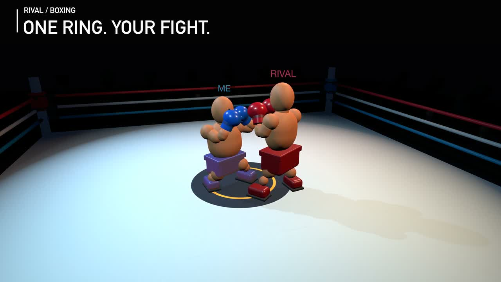
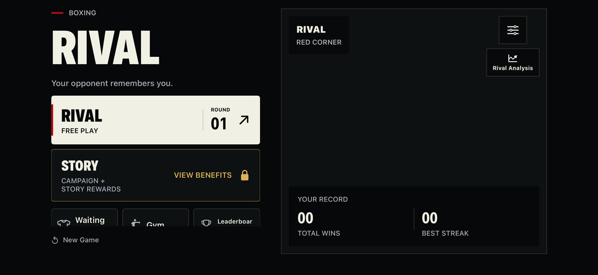
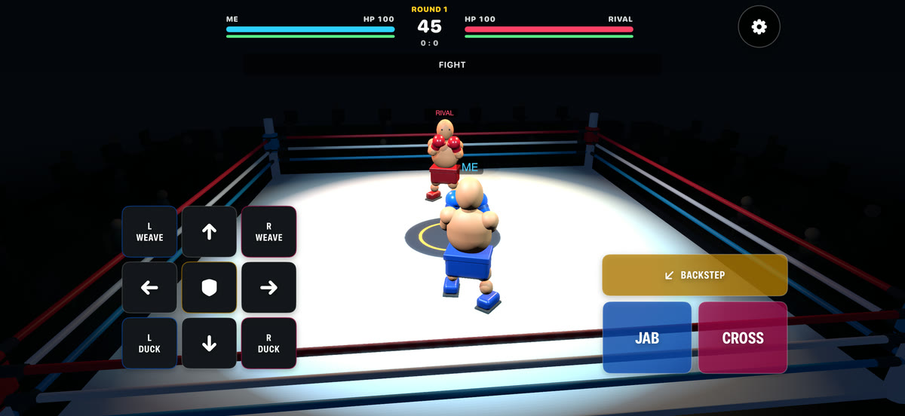
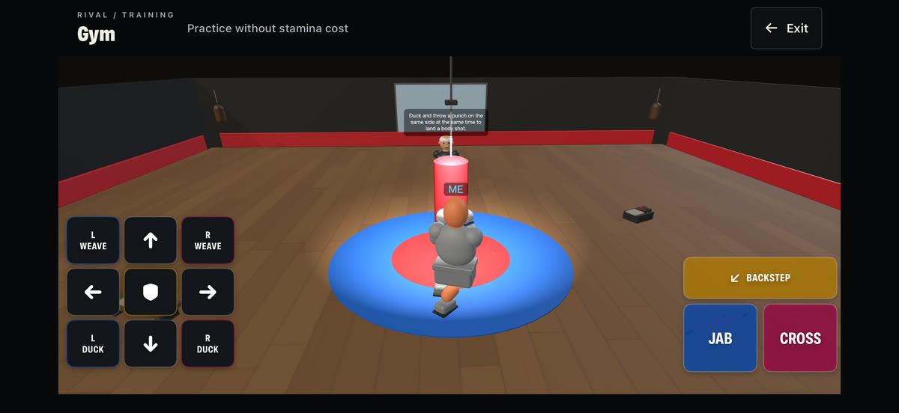
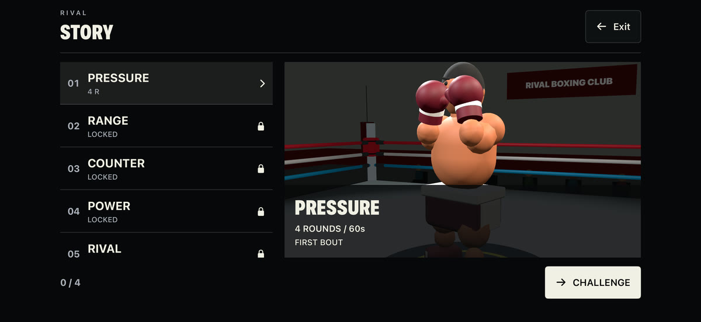
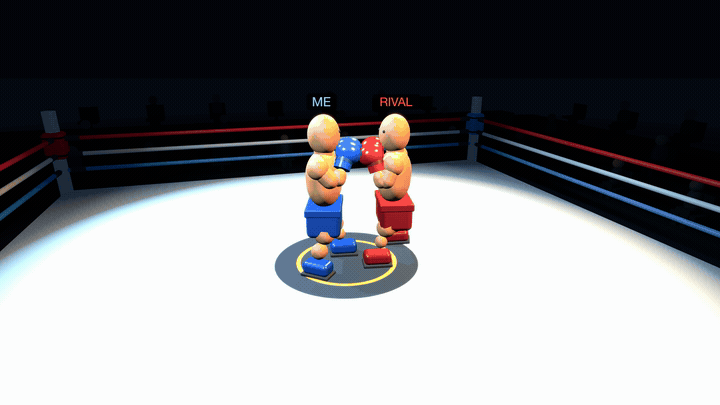
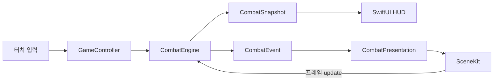

<!-- markdownlint-configure-file {"MD033": {"allowed_elements": ["h1", "p", "strong", "a", "img", "br", "sub", "table", "tr", "td"]}} -->

<h1 align="center">RIVAL</h1>

<p align="center">
  라운드 사이에 플레이어의 습관을 학습하는 iPhone·iPad 네이티브 3D 복싱 게임.
</p>

<p align="center">
  <strong>8 Punches</strong> · <strong>5 Opponents</strong> · <strong>On-Device AI</strong>
</p>

<p align="center">
  <a href="ios-pixel-boxing/PromotionVideos/RIVAL-SportsHighlights-CounterHQ-24s-1080p.mp4?raw=true">
    
  </a>
  <br>
  <sub>24초 홍보 영상의 2.5초 프레임 · 1280 x 720 · 클릭하여 1080p MP4 원본 열기</sub>
</p>

<p align="center">
  <a href="https://apps.apple.com/kr/app/rival/id6799909429">App Store</a> ·
  <a href="ios-pixel-boxing/PromotionVideos/RIVAL-SportsHighlights-CounterHQ-24s-1080p.mp4?raw=true">24초 영상 · 1080p</a> ·
  <a href="ios-pixel-boxing/PromotionVideos/RIVAL-SportsHighlights-CounterHQ-24s-4K.mp4?raw=true">4K 영상</a> ·
  <a href="docs/README.md">문서</a> ·
  <a href="ios-pixel-boxing/README.md">iOS 개발</a> ·
  <a href="SECURITY.md">보안</a>
</p>

> **소스 1.2(6) · 공개 버전과 구분**
> 2026-10-12 마지막 기록상 App Store 공개 앱은 **유료 1.1**입니다.
> 2026-10-11 제출 기록에서 앱·Story IAP·Total Wins 순위표는 모두 `Waiting for Review`, 출시 방식은 `MANUAL`입니다.
> 이 페이지의 1.2 화면은 출시 예고이며, 1.2 출시·무료 전환 완료를 뜻하지 않습니다. 상세: [출시 체크리스트](docs/release/RELEASE_READINESS_CHECKLIST.md).

## 플레이 경험

거리, 방향, 타이밍을 읽고 빈틈을 만드는 복싱. 반복하는 선택은 다음 라운드의 상대가 기억합니다.

| 나를 기억하는 상대 | 눈에 보이는 접촉 | 링 밖으로 이어지는 도전 |
| --- | --- | --- |
| 한 라운드 동안 학습 정책은 고정합니다. 관측은 라운드 종료 시 승패와 무관하게 확정하고, 다음 라운드부터 반영합니다. | 렌더링과 공유하는 포즈·장갑 궤적으로 swept 접촉을 판정합니다. 조준은 공격 시작 때 고정하고, 실제 접촉 시각의 방어 상태를 적용합니다. | 서로 다른 5명 상대, 관장 공략, 체크포인트와 장면 다시 보기. 11개 JSON 시네마틱 모션을 기존 3D 리그에서 재생합니다. |

잽·크로스·좌우 바디·훅·어퍼컷에 더킹, 위빙, 백스텝을 연결합니다.
헛스윙 노출과 스태미나, 회피 후 반격이 버튼 연타보다 선택의 타이밍을 중요하게 만듭니다.

## 게임 화면

<table>
  <tr>
    <td width="50%" align="center">
      
      <br><strong>메인 메뉴</strong>
      <br><sub>RIVAL 경기와 스토리 진입</sub>
    </td>
    <td width="50%" align="center">
      
      <br><strong>RIVAL 경기</strong>
      <br><sub>거리 싸움과 가로형 터치 HUD</sub>
    </td>
  </tr>
  <tr>
    <td width="50%" align="center">
      
      <br><strong>체육관</strong>
      <br><sub>공격·회피·연계 동작 연습</sub>
    </td>
    <td width="50%" align="center">
      
      <br><strong>스토리 진행</strong>
      <br><sub>상대별 도전과 클리어 기록</sub>
    </td>
  </tr>
</table>

<sub>1.2 Release의 iPhone 시뮬레이터·로컬 StoreKitTest 캡처입니다. 프로덕션 구매·해금 검증을 뜻하지 않습니다.</sub>

## 회피에서 반격으로

<p align="center">
  <a href="ios-pixel-boxing/PromotionVideos/RIVAL-SportsHighlights-CounterHQ-24s-1080p.mp4?raw=true">
    
  </a>
  <br>
  <sub>720 x 405 · 3.5초 · 12fps 미리보기 · 클릭하여 전체 24초 영상 열기</sub>
</p>

<sub>2026-10-12 실제 엔진의 DEBUG 연출용 캡처로 제작했습니다. 일반 터치 플레이나 실기기 성능 측정이 아닙니다.</sub>
[캡처 기록](ios-pixel-boxing/PromotionAssets/Captures/2026-10-12/README.md) · [영상 제작 기록](ios-pixel-boxing/PromotionVideos/README.md)

## 기술 구성

**Swift 6 · SwiftUI · SceneKit · iOS 17+** / iPhone·iPad 가로 화면



`GameController`가 스냅샷 게시와 이벤트 전달을 연결하며, 실제 전투 시간은 `Arena3DScene.update`에서 진행합니다.
피해·회피 판정과 카메라·소리·햅틱 연출의 책임을 나눕니다. [아키텍처](docs/engineering/ARCHITECTURE.md)

핵심 경기와 습관 학습은 온디바이스로 동작하며 외부 모델·AI API를 사용하지 않습니다.
선택적 Apple Game Center와 StoreKit의 순위·구매 기능에는 네트워크 연결을 사용합니다.

## 시작하기

Xcode에서 [RIVAL.xcodeproj](ios-pixel-boxing/RIVAL.xcodeproj/)를 열고 `RIVAL` 스킴을 사용합니다.
보존된 Xcode 프로젝트가 기준이며, XcodeGen 재생성은 기본 절차가 아닙니다.

```bash
cd ios-pixel-boxing
xcodebuild \
  -project RIVAL.xcodeproj -scheme RIVAL \
  -configuration Debug -sdk iphoneos \
  -destination 'generic/platform=iOS' \
  CODE_SIGNING_ALLOWED=NO build
```

위 명령은 서명 없는 generic iOS 빌드 예시입니다. 실기기 설치·배포에는 유효한 개발자 서명이 필요합니다.
설정과 배포 절차: [ios-pixel-boxing/README.md](ios-pixel-boxing/README.md).

## 저장소 안내

| 경로 | 역할 |
| --- | --- |
| [ios-pixel-boxing/](ios-pixel-boxing/) | 현재 iOS 앱·리소스·테스트·제작 도구·홍보 영상. 기존 경로를 유지합니다. |
| [docs/](docs/) | product · engineering · release · media · portfolio · legacy로 나눈 문서와 미디어 |
| [legacy/](legacy/) | terminal-cpp · python · godot의 이전 구현 |
| [pixel-boxing/](pixel-boxing/) | 웹 프로토타입과 지원·개인정보 페이지. GitHub Pages 경로를 유지합니다. |
| [CMakeLists.txt](CMakeLists.txt) | 레거시 터미널 C++ 빌드의 루트 래퍼 |
| [scripts/](scripts/) | 루트 터미널 실행·지원 도구 |

C++ 터미널에서 Python·웹 프로토타입을 거쳐 네이티브 iOS로 발전한 개인 프로젝트입니다.
이전 구현은 규칙의 기원과 이식 과정을 비교하는 자료이며, 현재 제품의 기준은 iOS 소스입니다.

## 더 읽기

- [전체 문서](docs/README.md): 제품·기술·출시 자료의 진입점
- [게임 의도와 설계 철학](docs/product/RIVAL_GAME_INTENT_AND_DESIGN_PHILOSOPHY.md) · [게임 가이드](docs/product/GAME_GUIDE.md)
- [AI 설계·활용](docs/engineering/AI_USAGE.md) · [개발 문제와 해결 사례](docs/engineering/DEVELOPMENT_ISSUES_AND_SOLUTIONS.md)
- [보안 경계](docs/engineering/SECURITY_BOUNDARIES.md) · [보안 제보](SECURITY.md)
- [포트폴리오](docs/portfolio/README.md): 과거 제출 PDF는 보존 자료이며 현행 Markdown과 구분합니다.

## 라이선스

[MIT License](LICENSE)는 저장소의 소스 코드에 적용됩니다. 음악·서드파티 자산은 각각의 별도 라이선스를 따릅니다.
홍보 음악의 사용 범위와 원본 재배포 제한: [음악 라이선스 기록](ios-pixel-boxing/PromotionAssets/Audio/README.md).
