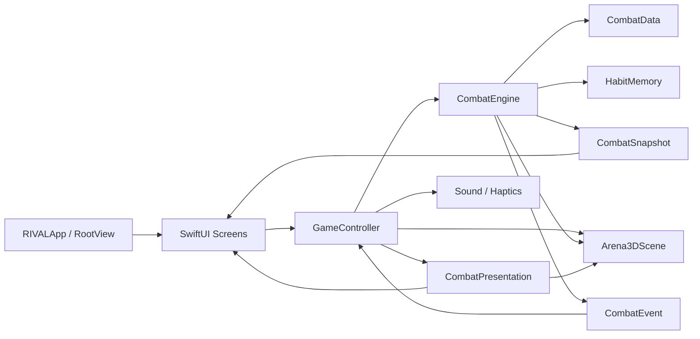

# RIVAL

플레이어의 반복 습관을 기억하고 라운드가 진행될수록 대응 방식을 바꾸는 **iPhone·iPad 가로형 3D 복싱 게임**입니다. 현재 저장소의 메인 제품은 Swift 6, SwiftUI, SceneKit으로 구현한 네이티브 iOS 앱입니다. Python·웹·C++ 버전은 RIVAL로 발전하기까지의 규칙 검증과 이식 과정을 보여주는 이전 구현으로 함께 보존합니다.

## 앱 확인

| 항목 | 링크 및 상태 |
| --- | --- |
| App Store | [RIVAL](https://apps.apple.com/kr/app/rival/id6799909429) · 2026-10-12 기록상 공개 1.1 유료 앱, US$1.99 / KRW 3,300 |
| TestFlight 외부 테스트 | [RIVAL Public Test](https://testflight.apple.com/join/btSgA8uT) · 현재 빌드·초대 상태 별도 확인 필요 |
| 플레이 영상 | [YouTube에서 보기](https://youtu.be/01h8Lo5UIJc?si=z4azF3XPkZuc9WOX) |
| 게임 소개·플레이 설명 | [PDF](ios-pixel-boxing/RIVAL_GAME_GUIDE.pdf) · [Markdown 원본](ios-pixel-boxing/GAME_GUIDE.md) |
| AI 활용 기술 설명 | [PDF](ios-pixel-boxing/RIVAL_AI_USAGE.pdf) · [Markdown 원본](ios-pixel-boxing/AI_USAGE.md) |
| 게임 의도·고도화 기준 | [RIVAL 게임 의도와 설계 철학](docs/RIVAL_GAME_INTENT_AND_DESIGN_PHILOSOPHY.md) |
| iOS 빌드·배포 안내 | [ios-pixel-boxing/README.md](ios-pixel-boxing/README.md) |

현재 문서 기준은 **2026-10-12의 RIVAL 1.2(6) iOS 작업 트리**이며 iOS 17 이상 iPhone·iPad에서 가로 화면으로 실행됩니다.
작업 트리와 같은 버전의 보존 아카이브, 과거 제출 PDF, 실제 App Store/TestFlight 배포본은 구분합니다.
과거 PDF는 현재 Markdown과 별도 산출물이며 자동 재생성하지 않습니다. 이번 문서 정리에서는 앱 빌드·테스트·실행이나 스토어 상태 조회를 새로 수행하지 않았습니다.

## 게임 핵심

일반 RIVAL은 단순히 체력과 공격력이 커지는 상대가 아닙니다. 한 라운드 안에서는 학습 정책을 고정하고 관측만 수집합니다.
`tacticalRead`는 라운드 시작 때 이전 완료 라운드의 확정 프로필에서 정합니다. 종료 시 승패와 무관하게 습관과 양측 공격 결과를 병합해
`pixelBoxingHabitMemory`·`pixelBoxingRivalResults`에 저장하고 다음 라운드부터 반영합니다.
현재 거리·스태미나·눈에 보이는 공격에 대한 고정 정책의 상황 반응은 실시간 학습이 아닙니다.
`RecentHabitMemory`와 시간 감쇠 기반 실시간 학습은 제거됐습니다. 라운드별 숙련도는 별도로 판단 속도·풋워크·습관 대응·짧은 연계를 높이되,
일반 RIVAL의 HP·피해·사거리는 올리지 않습니다. 스토리 강타형의 명시적 상대 수치는 이 원칙과 구분합니다.

- 잽, 크로스, 좌우 바디, 좌우 훅, 좌우 어퍼컷으로 구성된 8종 공격
- 상대 공격 손에 맞춰 방향을 선택하는 좌우 더킹
- 1회 위빙과 같은 쪽 훅 연계, 공통 관절 포즈 기반 활성 구간의 swept 접촉 판정
- 가드 파괴, 백스텝, 헛스윙 노출, 카운터 보너스와 반복 기술 약화
- 플레이어 승리 때만 올라가는 45초 라운드, 승패와 무관한 습관 확정
- 앱을 종료해도 `UserDefaults`에 유지되는 플레이 습관 메모리
- SceneKit 노드와 관절로 생성한 3D 링, 복서, 조명, 카메라와 KO 모션
- SwiftUI 기반 가로형 터치 HUD와 이벤트 기반 소리·햅틱·중요 순간 연출
- 4단계 더킹, 회피 순간의 RIVAL MOMENT, KO 낙하 후 공개되는 결과와 수동 다음 라운드
- 5명 상대의 스토리, 관장 공략, 인트로·승리·엔딩, 체크포인트 이어하기와 해금된 장면 다시 보기

현재 AI는 훈련된 외부 모델이나 외부 AI API를 실행하지 않습니다. 습관 원본은 기기 안에서만
사용하며 핵심 경기는 오프라인으로 동작합니다. 선택적 Game Center에는 총승·선호 스타일·
최고 라운드를 제출하므로 앱 전체에 네트워크 통신이 없다고 표현하지 않습니다.

## 조작

화면 왼쪽의 이동·방어 버튼과 오른쪽의 `JAB`, `CROSS`를 함께 사용합니다.

| 홀드 입력 | JAB | CROSS |
| --- | --- | --- |
| 없음 | 잽 | 크로스 |
| 중앙 가드 | 왼쪽 어퍼컷 | 오른쪽 어퍼컷 |
| L 더킹 | 왼쪽 바디 | 오른쪽 훅 |
| R 더킹 | 왼쪽 훅 | 오른쪽 바디 |

`BACKSTEP`은 기본 비용 31에 스타일 배율을 적용하고, 시작 방향의 반대로 0.18초 동안 최대 34 게임 단위를 이동합니다.
순간이동이나 전체 동작 무적이 아니며 회피 구간은 0.035초 이상·0.18초 미만입니다. 이동은 링·선수 충돌 경계를 따릅니다.
기본 전진·횡이동 속도는 210에 스타일 배율을 적용하고, 후퇴는 스타일 이동 보너스 없이 기본 속도의 0.5배입니다.
더킹 중 기본 이동은 0.5배이며 공격·가드·피격 경직·탈진·위빙·백스텝 중에는 기본 이동이 제한됩니다.
일반 스태미나 회복은 초당 11이며 공격·가드·더킹·위빙·탈진 중에는 회복하지 않습니다.

위빙은 비용 9, 동작 0.36초, 훅 시작 0.23초, 종료 뒤 입력 유예 0.12초, 총 재시작 대기 0.48초입니다.
머리 공격에 맞는 방향과 더킹량 0.70 이상이 필요하며 회피 진입은 `0.09 × 0.70 ≈ 0.063초`, 종료는 0.27초 미만입니다.
진입부터 0.23초까지 최대 12만큼 측면 이동하고 L 위빙→JAB은 왼훅, R 위빙→CROSS는 오른훅으로 연결합니다.
체육관에서는 위빙·연계 훅도 비용 없이 연습합니다.

공격은 `activeStart`~`activeEnd`에 렌더러와 공유하는 포즈·장갑 궤적의 swept 접촉을 검사합니다.
실제 접촉 시각의 가드·더킹·위빙·백스텝·무적 상태를 적용하고, 양측 후보를 먼저 계산해 공통 프레임 시작 대비 접촉 시간순으로 처리합니다.
공격 시작 때 조준과 방향을 고정하므로 상대가 움직여도 공격 중 추적 조준하지 않습니다.
자세한 피해·가드 비용·라운드 규칙은 [게임 설명서](ios-pixel-boxing/GAME_GUIDE.md)를 따릅니다.

## 스토리와 이용권

- 압박형 → 견제형 → 카운터형 → 강타형 → RIVAL의 5명 상대, 관장 공략·인트로·승리·엔딩을 제공합니다.
- Blender에서 생성한 JSON 모션 11개를 로드해 기존 공용 절차적 복서·관장 리그에 적용합니다. 동영상 재생이나 Blender 런타임은 아닙니다.
- 스토리 진행·체크포인트·학습은 일반 경기와 분리해 저장하며 이어하기와 획득한 장면 다시 보기를 제공합니다.
- 1회 구매 비소모성 Story IAP 이용권과 승리 보상을 분리합니다. 퍼스트 벨(First Bell)은 구매 권한으로 즉시 해금되고, 상대 외형·챔피언 복장·벨트는 검증된 이용권과 해당 클리어가 모두 필요합니다.
- 현재 Debug 전체 미리보기는 `rival.story.preview.v1` 저장소와 비영속 경기로 실제 통계·장비·랭킹 저장을 막습니다. Release 우회는 `false`이며 실구매 검증 시 Debug 미리보기를 꺼야 합니다.
- 스토리 강타형만 HP 120·리치 +4 게임 단위·피해 1.15배입니다. 실제 비용·사거리·도달 조건을 만족하는 동안 연타하고 공격 비용이 부족하면 45까지 회복합니다. 회복 진입 때만 최대 2초 가드·초당 6 회복, 시간 만료 뒤 재가드 없이 초당 16.5 회복을 사용합니다. 피격 경직·탈진·가드 붕괴 조건은 유지합니다.
- 스토리 최종 RIVAL은 상한이 있는 숙련 정책·짧은 스텝·최대 3타와 회복 틈을 사용합니다. 이전 완료 라운드의 습관을 읽되 실시간 학습하지 않습니다. 일반 RIVAL·최종 RIVAL의 HP·리치·공격력 증가로 설명하지 않습니다.

근거: [StoryMode.swift](ios-pixel-boxing/PixelBoxingIOS/StoryMode.swift), [StoryPurchaseStore.swift](ios-pixel-boxing/PixelBoxingIOS/StoryPurchaseStore.swift), [CombatCore.swift](ios-pixel-boxing/PixelBoxingIOS/CombatCore.swift).

## 제출·홍보 상태

2026-10-11 서명된 `1.2(6)` 아카이브와 업로드를 완료한 기록이 있으며, **06:31 GMT+9**에 앱·첫 Story IAP·첫 Total Wins 순위표를 함께 심사 제출했습니다.
마지막 확인 당시 세 항목 모두 `Waiting for Review`, 출시 방식은 `MANUAL`입니다. 승인·출시·무료 전환 완료가 아닙니다.
2026-10-12 공개 앱 기록은 유료 1.1(4), US$1.99 / KRW 3,300입니다. Story IAP 등록 가격은 KRW 4,400 / USD 2.99 / JPY 500입니다.
기존 유료 구매자 권한은 검증된 Production 원본 빌드 `1...4`에만 적용하며 무료 가격 전환·버전 배포 시차의 자격 경계는 미해결입니다.

10월 11일 Release 캡처 테스트 6개·이미지 30장은 UI-test-only 로컬 StoreKitTest 결과입니다.
전체 회귀나 실계정 구매·복원·권한 취소·기존 구매자 이행·Game Center 제출/재조회 검증이 아닙니다.
근거는 [제출 영수증](ios-pixel-boxing/AppStoreMetadata/1.2-submission.json)과 [출시 체크리스트](ios-pixel-boxing/RELEASE_READINESS_CHECKLIST.md)이며 이번에 새 조회·빌드는 하지 않았습니다.

2026-10-12 홍보 기록에는 HQ 24초 4K/60fps 가로 영상과 24초 1080×1920/30fps 세로 영상이 있습니다.
전투 컷은 격리된 Debug 실제 엔진의 연출용 캡처이며 일반 터치 플레이나 기기 성능 측정이 아닙니다. 원본 스토리 녹화는 확대 사용했으므로 모든 컷이 네이티브 4K는 아닙니다.
전체 디코딩·24초 PCM 샘플 검사는 파일 무결성 근거이며 FPS·발열 검증이 아닙니다. Reddit·Instagram 게시와 Meta 유료 광고 심사 요청은 별개이고, 광고 승인·실제 게재·성과는 미확인입니다.
상세 범위는 [홍보 영상·게시 기록](ios-pixel-boxing/PromotionVideos/README.md)과 [개발 문제·해결 기록](ios-pixel-boxing/DEVELOPMENT_ISSUES_AND_SOLUTIONS.md)을 따릅니다.

## 소스 코드 지도

메인 앱 소스는 모두 [`ios-pixel-boxing`](ios-pixel-boxing/)에 있습니다. 특정 기능을 확인하거나 수정하려면 아래 파일부터 보면 됩니다.

| 확인할 기능 | 소스 파일 | 주요 내용 |
| --- | --- | --- |
| 앱 시작점과 생명주기 | [PixelBoxingApp.swift](ios-pixel-boxing/PixelBoxingIOS/PixelBoxingApp.swift) | `RIVALApp`, `AppDelegate`, 가로 방향 고정과 최초 화면 생성 |
| 전투 수치와 8종 공격 | [CombatCore.swift](ios-pixel-boxing/PixelBoxingIOS/CombatCore.swift) | `Punch`, `AttackSpec`, `CombatData`에 피해량·사거리·스태미나 비용·더킹 방향 정의 |
| 라운드와 적중 판정 | [CombatCore.swift](ios-pixel-boxing/PixelBoxingIOS/CombatCore.swift) | `FighterModel`, `CombatEngine`이 이동, 공격, 가드, 노출, 카운터, KO와 라운드 처리 |
| 플레이 습관·공격 결과 학습 | [CombatCore.swift](ios-pixel-boxing/PixelBoxingIOS/CombatCore.swift) · [RivalAI.swift](ios-pixel-boxing/PixelBoxingIOS/RivalAI.swift) | 완료 라운드의 습관·양측 공격 결과 병합과 다음 라운드 고정 정책 |
| 화면용 게임 상태 | [CombatCore.swift](ios-pixel-boxing/PixelBoxingIOS/CombatCore.swift) | `CombatSnapshot`, `CombatCommentary`가 HUD 수치와 경기 해설 제공 |
| 입력·전투·햅틱 연결 | [GameController.swift](ios-pixel-boxing/PixelBoxingIOS/GameController.swift) | `GameController`가 터치 홀드, 조합 공격, 백스텝, 학습 초기화와 햅틱을 엔진에 연결 |
| 3D 링과 복서 | [Arena3DScene.swift](ios-pixel-boxing/PixelBoxingIOS/Arena3DScene.swift) | `Arena3DScene`, `BoxerRig`이 링·로프·객석·관절형 복서·공격·피격·KO 자세 생성 |
| 카메라와 렌더링 | [Arena3DScene.swift](ios-pixel-boxing/PixelBoxingIOS/Arena3DScene.swift) | 어깨너머 카메라, 거리 기반 줌, 회전 제한, 프레임 업데이트와 SwiftUI 브리지 |
| 터치 HUD와 팝업 | [GameView.swift](ios-pixel-boxing/PixelBoxingIOS/GameView.swift) | HP·스태미나·라운드 HUD, 조작 버튼, 시작 안내, 일시정지와 학습 초기화 UI |
| 앱 리소스와 메타데이터 | [Assets.xcassets](ios-pixel-boxing/PixelBoxingIOS/Assets.xcassets/) · [Info.plist](ios-pixel-boxing/PixelBoxingIOS/Info.plist) | 앱 아이콘·색상과 표시 이름·가로 방향·전체 화면 설정 |
| 실제 프로젝트와 유지 명세 | [RIVAL.xcodeproj/project.pbxproj](ios-pixel-boxing/RIVAL.xcodeproj/project.pbxproj) · [project.yml](ios-pixel-boxing/project.yml) | 심사에 사용한 실제 프로젝트가 기준, 명세도 1.2(6)·iPhone/iPad·iOS 17 설정과 맞춰 유지 |
| 공통 전투 연출 | [CombatPresentation.swift](ios-pixel-boxing/PixelBoxingIOS/CombatPresentation.swift) | 판정 이벤트, 시그니처 우선순위, 카메라 임펄스·줌 곡선 |
| 메인 메뉴 디자인 | [MainMenuView.swift](ios-pixel-boxing/PixelBoxingIOS/MainMenuView.swift) · [MainMenuDesign.swift](ios-pixel-boxing/PixelBoxingIOS/MainMenuDesign.swift) | 라이벌 근접 초상, 무료 RIVAL·선택적 유료 Story 구분과 실제 기록 |
| 내부 메뉴와 버튼 | [RivalMenuComponents.swift](ios-pixel-boxing/PixelBoxingIOS/RivalMenuComponents.swift) | 공용 제목·닫기·선택 상태, 전체 화면 대기실·랭킹과 작은 설정 패널 |
| 잽·크로스와 피격 모션 | [BoxingMotion.swift](ios-pixel-boxing/PixelBoxingIOS/BoxingMotion.swift) | 기존 판정 시점에 맞춘 신전, 하체→상체 회전, 부위별 피격 |
| 단위 회귀 테스트 | [PlaceholderTests.swift](ios-pixel-boxing/PixelBoxingIOSTests/PlaceholderTests.swift) · [CombatPresentationTests.swift](ios-pixel-boxing/PixelBoxingIOSTests/CombatPresentationTests.swift) · [MainMenuPresentationTests.swift](ios-pixel-boxing/PixelBoxingIOSTests/MainMenuPresentationTests.swift) · [BoxingMotionTests.swift](ios-pixel-boxing/PixelBoxingIOSTests/BoxingMotionTests.swift) | 전투·연출·저장·메뉴·모션 검사 소스, 날짜별 실행 결과는 아래 과거 기록 |
| 가로 UI 테스트 | [PixelBoxingIOSUITests.swift](ios-pixel-boxing/PixelBoxingIOSUITests/PixelBoxingIOSUITests.swift) | 현재 메뉴→경기, 가로 조작부, KO→다음 라운드, 동작 줄이기 |
| TestFlight 내보내기 | [ExportOptions.plist](ios-pixel-boxing/ExportOptions.plist) · [TestFlightUploadOptions.plist](ios-pixel-boxing/TestFlightUploadOptions.plist) | App Store Connect 배포와 업로드 옵션 |
| 앱 아이콘 생성 | [generate_app_icon.swift](ios-pixel-boxing/scripts/generate_app_icon.swift) | 외부 이미지 없이 앱 아이콘을 생성하는 Swift 스크립트 |

심사에 사용한 실제 `RIVAL.xcodeproj`를 함께 보존합니다. `project.yml`은 유지된 XcodeGen 명세이며 설정 변경 시 양쪽의 일치를 확인합니다.
무조건 재생성하지 않습니다. 재생성이 필요하면 Story JSON 11개·개인정보 매니페스트·UI-test-only StoreKit fixture 등록과 스킴을 먼저 대조합니다.

## 앱 구조



1. `RIVALApp`의 `RootView`가 오프닝·메뉴·VS·실전·체육관 화면을 관리합니다.
2. `GameView`의 버튼 입력은 `GameController`를 통해 `CombatEngine`으로 전달됩니다.
3. `CombatEngine`은 `CombatData`의 공격 규칙과 이전 완료 라운드의 습관·공격 결과 정책으로 전투와 RIVAL 행동을 결정합니다. 현재 라운드 관측은 종료 시 병합합니다.
4. 결과는 `CombatSnapshot`으로 HUD에 전달됩니다. 적중·회피의 `CombatEvent`는 HUD 주기와 별개로 소리·햅틱·시그니처·카메라에 전달합니다.
5. 입력, 규칙, 화면 상태와 3D 표현을 분리해 전투 판정을 SceneKit 애니메이션과 독립적으로 테스트할 수 있습니다.

## 빌드와 과거 검증

아래 날짜별 기록은 당시 소스와 실행 범위의 역사이며 현재 1.2(6)의 전체 회귀 통과를 의미하지 않습니다.

2026-09-07 내부 메뉴·잽/크로스·피격 고급화까지 검증: iPhone 12 mini 단위 테스트 **82개**, 실기기 UI 테스트 **11개** 통과.
Debug iPhone SDK 테스트 번들과 Release iPhone SDK 빌드도 성공했습니다. 화면 캡처 확인과
게임의 손맛·장기 성능 측정은 구분하며, 다음 개선은 사용자 플레이 피드백 후 진행합니다.

아래는 보존된 실제 프로젝트를 사용하는 재현 명령이며 이번 문서 정리에서는 실행하지 않았습니다. 기존 Xcode 프로젝트가 있으면 XcodeGen 재생성은 필수가 아닙니다.

```bash
cd ios-pixel-boxing
xcodebuild \
  -project RIVAL.xcodeproj \
  -scheme RIVAL \
  -sdk iphoneos \
  -destination 'generic/platform=iOS' \
  CODE_SIGNING_ALLOWED=NO \
  build-for-testing
```

위 명령은 시뮬레이터를 실행하지 않고 generic iOS 실기기 대상으로 앱과 테스트 타깃의 컴파일을 검증합니다. 실제 iPhone 실행과 TestFlight Archive에는 [`project.yml`](ios-pixel-boxing/project.yml)에 설정된 Apple Developer Team의 유효한 서명이 필요합니다.

## 개발 과정

이 프로젝트는 표현 방식을 먼저 정한 것이 아니라, 각 버전에서 확인한 한계를 다음 구현의 질문으로 바꾸며 발전했습니다.

| 단계 | 구현 | 확인한 내용 |
| --- | --- | --- |
| 1 | C++20 터미널 TUI | 실시간 전투, 라운드, HP·스태미나, 저장과 플레이 패턴 기록 |
| 2 | 브라우저·Tkinter 횡 액션 | 공격·회피 입력, 타격 모션과 화면 피드백 |
| 3 | Python Pixel Boxing Top-Down | 링 안 360도 이동, 의사 3D 카메라, 방향 더킹과 8종 공격 규칙 |
| 4 | Swift RIVAL iOS | 네이티브 터치 입력, SceneKit 3D 복서, 온디바이스 적응형 AI와 TestFlight 배포 |

핵심 판단 기준은 버튼 연타보다 거리·방향·타이밍이 이기게 만드는 것입니다. 헛스윙 노출, 카운터, 반복 기술 약화, 스태미나와 탈진을 연결했고, RIVAL은 플레이어의 반복 선택을 점차 공략하도록 설계했습니다.

## 저장소 구성

| 경로 | 역할 |
| --- | --- |
| [`ios-pixel-boxing`](ios-pixel-boxing/) | 현재 메인 RIVAL iPhone·iPad 앱, Swift 전투 엔진, SceneKit 3D 화면, 테스트와 제출 문서 |
| [`desktop-pixel-boxing`](desktop-pixel-boxing/) | iOS 이식 기준이 된 Python/Tkinter 탑다운 구현과 이전 횡 액션 프로토타입 |
| [`pixel-boxing`](pixel-boxing/) | 설치 없이 확인할 수 있는 [GitHub Pages 웹 이식판](https://acertainromance401.github.io/GAME/) |
| [`include`](include/) · [`src`](src/) | 아이디어를 처음 검증한 C++20 터미널 TUI와 학습 AI |
| [`tests`](tests/) | Python 전투 코어와 UI 동작을 검증하는 레거시 회귀 테스트 |
| [`docs`](docs/) | 프로젝트 구조와 기존 설계 자료 |

현재 제품 기능은 iOS 소스를 기준으로 확인하고, 이전 버전은 규칙의 기원과 구현 변화를 비교할 때 사용합니다.

## 라이선스

이 저장소의 소스 코드는 [MIT License](LICENSE)로 공개되어 있습니다. 라이선스가 별도로 있는 음악·서드파티 자산까지 MIT로 배포하는 것은 아닙니다.
Mixkit 음악은 허용된 상업용 온라인 영상·광고에만 사용하며 인게임 음악 사용·원본 음원 재배포 권한으로 해석하지 않습니다. [음악 사용 기록](ios-pixel-boxing/PromotionAssets/Audio/README.md)을 따릅니다.
