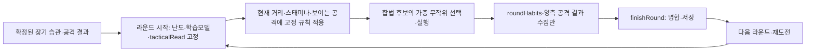

# RIVAL AI 활용 기술 문서

| 항목 | 내용 |
| --- | --- |
| 대상 코드 | RIVAL 1.2(6) 작업 트리 · 스토어 배포본과 구분 |
| 플랫폼 | iPhone·iPad 가로 전용 · iOS 17 이상 |
| 게임 내 AI 방식 | 규칙·통계·가중 확률 기반 적응형 의사결정 |
| 생성형 AI 사용 | GitHub Copilot을 개발 보조로 사용 |
| 외부 AI API | 사용하지 않음 |
| 습관 데이터 전송 | 없음 · 선택적 Game Center에는 총승·선호 스타일·최고 라운드 제출 |
| 문서 기준일 | 2026년 10월 12일 · 현재 소스·기존 제출 기록 대조 |

## 문서 범위

`1.2(6)`는 마케팅 버전 `1.2`, 빌드 번호 `6`입니다. 실제 기준은
[RIVAL.xcodeproj/project.pbxproj](../../ios-pixel-boxing/RIVAL.xcodeproj/project.pbxproj)이며
[project.yml](../../ios-pixel-boxing/project.yml)도 일치합니다. 문서 갱신을 위해 프로젝트를 재생성하지 않습니다.
2026-10-12 확인 당시 공개 App Store는 유료 1.1(USD 1.99 / KRW 3,300)이며 무료 전환·1.2 출시는 미완료입니다.
2026-10-11 서명된 Release 1.2(6) 아카이브 업로드와 앱·Story IAP·Total Wins 순위표의
3항목 동반 심사 제출 기록은 `Waiting for Review`, 수동 출시(`MANUAL`)입니다.
근거는 [제출 영수증](../../ios-pixel-boxing/AppStoreMetadata/1.2-submission.json)과
[출시 체크리스트](../release/RELEASE_READINESS_CHECKLIST.md)이며 오늘 새 조회·빌드 결과가 아닙니다.
당시 로컬 Release StoreKitTest UI 캡처는 6개 통과·첨부 30개인 제한된 화면 검증입니다.
실계정 구매·복원·권한 취소·기존 유료 고객 이행·Game Center는 미검증입니다.
날짜별 실험 기록은 당시 범위를 유지하며, 이번 작업은 문서 검사만 수행합니다.

RIVAL에는 서로 목적이 다른 두 종류의 AI 활용이 있습니다.

| 구분 | 역할 | 실행 시점 |
| --- | --- | --- |
| 게임 내 적응형 AI | 완료 라운드의 습관·공격 결과로 다음 라운드의 행동 가중치를 조정 | 앱 실행 중, 기기 내부 |
| 생성형 AI 개발 보조 | 요구사항 정리, Swift 코드·테스트·문서 초안 작성과 오류 분석 보조 | 개발 과정에서만 사용 |

게임 앱에는 생성형 AI 모델이나 대화 기능이 포함되지 않습니다. 게임 내 RIVAL도 LLM이나 외부 AI API가 아니라 Swift로 직접 구현한 규칙·통계 기반 의사결정 시스템입니다.

### 핵심 구분

- **게임 내 적응형 AI:** 라운드 중에는 난도·학습모델을 고정하고 관측만 수집합니다. 완료 라운드의 통계를 다음 라운드·재도전부터 사용합니다.
- **생성형 AI 개발 보조:** 개발자가 코드를 만들고 검토하는 과정에서 사용한 도구입니다. 완성된 앱 안에는 포함되지 않으며 플레이 중 호출되지 않습니다.
- **강화학습 여부:** 현재 iOS 빌드는 신경망을 학습하거나 보상으로 정책을 갱신하는 강화학습 모델이 아닙니다. 행동 규칙과 가중치가 소스 코드에 명시된 설명 가능한 적응형 시스템입니다.

이 구분은 “AI를 사용했다”는 표현이 앱 내부 모델 실행과 개발 도구 사용을 혼동하지 않도록 하기 위한 것입니다.

## 게임 내 적응형 AI 구조

### 전체 흐름



핵심 구현은 [CombatCore.swift](../../ios-pixel-boxing/PixelBoxingIOS/CombatCore.swift)의 `HabitMemory`, `HabitSnapshot`,
`CombatEngine`과 [RivalAI.swift](../../ios-pixel-boxing/PixelBoxingIOS/RivalAI.swift)의 `RivalAttackMemory`입니다.
`roundHabits`·`roundPlayerAttackResults`·`roundRivalAttackResults`는 관측 버퍼일 뿐입니다.
일반 RIVAL은 `finishRound`에서 승패와 무관하게 병합·저장하며 다음 라운드·재도전부터 반영합니다.
`tacticalRead`는 라운드 시작에 확정 장기 습관으로 결정합니다. 종료 시 다음 보고용 값을 갱신해도
전투 도중 모델을 바꾸는 것은 아닙니다. 현재 거리·스태미나·노출·공격 결과에 대한 고정 상황 반응은 학습과 구분합니다.

### 구현 구성요소

| 구성요소 | 책임 | 입력 | 출력 |
| --- | --- | --- | --- |
| `CombatEngine` | 전투 상태 갱신과 RIVAL의 판단 주기 관리 | 프레임 경과시간, 플레이어 입력, 전투 상태 | 이동, 공격, 회피, 라운드 결과 |
| `HabitMemory` | 플레이 습관 누적과 직렬화 | 공격 시작, 가드·더킹·이동 상태 | 누적 횟수와 시간 표본 |
| `HabitSnapshot` | 누적값을 비율과 적응도로 변환 | `HabitMemory` | 습관 비율, 표본 강도, 행동 가중치 |
| `RivalReadProfile` / `tacticalRead` | 확정 장기 습관의 전술 읽기 | 라운드 시작의 저장 프로필 | 라운드 동안 고정된 전술 분류 |
| `RivalAttackMemory` | 양측 공격의 적중·가드·회피·헛침 결과 보존 | 완료 라운드의 결과 | 표본 신뢰도와 제한된 가중치 보정 |
| `RivalDifficulty` | 라운드별 실행 능력 조절 | 현재 라운드 | 판단 간격, 반응 지연·확률, 이동·연계 활용도 |
| `AttackSpec` | 8종 공격의 고정 전투 규칙 | 공격 종류 | 시간, 피해, 사거리, 각도, 비용, 목표 부위 |
| `weightedChoice` | 가중치에 따른 행동 선택 | 행동별 0 이상의 가중치 | 하나의 행동 문자열 |
| `UserDefaults` | 세션 간 습관 보존 | `Codable` JSON 데이터 | 다음 앱 실행 시 복원할 메모리 |

화면 표현은 [Arena3DScene.swift](../../ios-pixel-boxing/PixelBoxingIOS/Arena3DScene.swift), 입력은
[GameView.swift](../../ios-pixel-boxing/PixelBoxingIOS/GameView.swift), 엔진 연결은
[GameController.swift](../../ios-pixel-boxing/PixelBoxingIOS/GameController.swift)가 담당합니다. 습관 대응·행동 선택은 3D 렌더링과 분리된
[CombatCore.swift](../../ios-pixel-boxing/PixelBoxingIOS/CombatCore.swift), 실행 숙련도·연계·난수는
[RivalAI.swift](../../ios-pixel-boxing/PixelBoxingIOS/RivalAI.swift)에 있습니다.

### 1. 플레이 습관 수집

`HabitMemory`는 다음 데이터를 누적합니다.

- 8종 공격별 사용 횟수와 가장 자주 사용한 공격
- 같은 공격을 연속으로 사용한 횟수
- 가드 유지 비율
- 왼쪽·오른쪽 더킹 비율
- 스토리에서는 실행 중인 왼쪽·오른쪽 위빙 방향을 기존 좌우 회피 표본에 합산
- 백스텝 비율
- 전진 압박과 후퇴 비율
- 현재까지 확보된 표본의 강도

공격은 버튼 입력이 실제 공격으로 시작됐을 때 기록합니다. 가드·더킹·이동은 매 프레임의 경과시간을 기준으로 표본화하므로 프레임 속도 차이가 습관 비율을 크게 바꾸지 않도록 했습니다.

#### 누적 데이터와 파생 데이터

| 누적 데이터 | 파생 데이터 | 의미 |
| --- | --- | --- |
| 공격별 사용 횟수 | 잽 비율, 바디 공격 비율, 선호 공격 | 플레이어가 반복하는 공격군 |
| 최근 공격과 연속 횟수 | `repeatStreak` | 같은 기술을 몇 번 연속 사용했는지 |
| 가드 표본 | `guardRatio` | 전체 관찰 중 가드를 유지한 비율 |
| 좌·우 더킹 표본 | `duckLeftRatio`, `duckRightRatio` | 한쪽 회피를 반복하는 경향 |
| 스토리의 좌·우 위빙 상태 | 기존 `duckLeftRatio`, `duckRightRatio`에 합산 | 독립 위빙 카운터·전술 분류는 없음 |
| 백스텝 동작 표본 | `backstepRatio` | 실제 백스텝 상태의 유지 비율 |
| 전진·후퇴 표본 | `pressureRatio`, `retreatRatio` | 압박형인지 거리 유지형인지 |
| 전체 표본량 | `sampleStrength` | 현재 관찰을 얼마나 강하게 반영할지 결정하는 값 |

공격 횟수는 실제 공격 시작에 성공했을 때만 증가합니다. 스태미나 부족이나 경직 때문에
시작되지 않은 입력은 기록하지 않습니다. 연속 상태는 `deltaTime × 8` 표본을 누적하고,
장기 프로필의 `sampleStrength = min(1, max(totalSamples, 0) / 900)`를 계산합니다.
이 값은 내부 가중치의 강도이지 플레이어를 이해한 정확도나 검증된 확률이 아닙니다.
이동은 상대 기준 `(전진, 횡이동)` 입력을 사용합니다. 공격·가드·경직·탈진으로 이동이
불가능한 입력은 전진·후퇴 관측에서 제외하지만, 벽 충돌 시 실제 변위를 표본화하는 구조는 아닙니다.

### 2. 적응도 계산

관측 근거인 적응 계수는 확정된 장기 프로필의 표본량을 사용합니다. 이 식 자체에는 라운드
번호를 넣지 않지만, 2026-09-09부터 별도의 `RivalDifficulty`가 라운드별 대응 실행 능력을 조절합니다.

```text
adaptation = clamp(0.18 + 0.57 × sampleStrength, 0.18, 0.75)
```

- 확정된 표본이 적을 때는 낮은 적응 계수를 사용합니다.
- 승패와 무관하게 완료된 라운드의 표본이 쌓이면 계수가 최대 `0.75`에 가까워집니다.
- 위 계수와 별개로 `experience = 1 - exp(-(max(1, round) - 1) / 55)`를 사용합니다.
   습관 대응 배율은 `0.45 + 1.85 × experience`입니다. 라운드가 높아도 관측되지 않은 행동을
   읽었다고 만들지는 않습니다. 판단 간격·이동 활용도·짧은 연계는 이 숙련 곡선으로 조절합니다.

실시간 최근 표본의 만료·반감기·주기적 전술 재평가 경로는 현재 사용하지 않습니다.
코너 리포트는 확정 습관의 전술 분류를 보여 주며, 내부 계수를 ‘학습 정확도 %’로 표현하지 않습니다.

양측의 `RivalAttackMemory`는 각각 최대 32개 결과를 보존합니다. 역순 증거 가중치는
기록마다 `0.94`배이며 `confidence = min(1, max(0, (samples - 2) / 6))`입니다.
적중·가드·더킹/위빙·백스텝·거리/각도/접촉 헛침을 구분하고 실행 불가 결과는 제외합니다.
공격별 곱셈 보정은 `0.50...1.20`으로 제한됩니다. 이 감쇠는 저장 결과의 순서 가중치이지
실시간 행동 표본의 반감기가 아니며, 보상으로 정책을 훈련하는 강화학습도 아닙니다.

### 3. 행동 가중치 생성

RIVAL의 선택 후보는 8종 공격, 좌우 더킹, 백스텝, 전진·후퇴·좌우 서클링·거리 차단, 대기입니다.
현재 거리·노출 상태와 라운드 시작에 고정된 장기 습관·전술 읽기·공격 결과로 가중치를 계산합니다.

| 관찰된 상황 | 가중치 변화 예시 |
| --- | --- |
| 원거리 | 기본 가중치에서는 긴 공격 선호, 실행 전 실제 사거리 밖 펀치는 제외하고 접근 |
| 근거리 | 바디샷·훅·어퍼컷 선호 증가 |
| 가드를 자주 사용 | 가드를 공략하는 바디샷 증가 |
| 한쪽 더킹 반복 | 해당 방향을 노리는 펀치 증가 |
| 잽 반복 | 크로스·오른쪽 훅·오른쪽 더킹 증가 |
| 바디 공격 반복 | 어퍼컷 증가 |
| 지속적인 전진 압박 | 백스텝과 훅 증가 |
| 잦은 후퇴·백스텝 | 잽·크로스로 추격할 확률 증가 |
| 같은 공격 3회 이상 반복 | 좌우 더킹 보정 규칙은 정의돼 있으나 현재 장기 프로필 입력에서는 적용되지 않음 |
| 플레이어가 노출 상태 | 강한 카운터 공격 확률 증가, 대기 확률 감소 |

생성된 가중치의 합 안에서 무작위 값을 하나 뽑아 행동을 선택합니다. 따라서 같은 상황에서도 항상 똑같이 반응하지 않지만, 반복 습관이 뚜렷할수록 대응 행동이 더 자주 등장합니다.

최종 추첨 전 `enemyActionWeights`가 실제 사거리와 스타일별 스태미나 비용으로 후보를
걸러냅니다. 같은 공격 반복의 자체 약화를 피하도록 RIVAL도 공격을 섞으며, 초반에는
단발·대기를 우선하고 후반에는 최대 두 공격의 짧은 연계를 더 자주 시도합니다.

#### 주요 임계값

| 조건 | 임계값 | 추가되는 대표 대응 |
| --- | ---: | --- |
| 가드 비율 | 0.22 초과 | 왼쪽·오른쪽 바디샷 증가 |
| 오른쪽 더킹 비율 | 0.16 초과 | 크로스·오른쪽 훅·오른쪽 어퍼컷 증가 |
| 왼쪽 더킹 비율 | 0.16 초과 | 잽·왼쪽 훅·왼쪽 어퍼컷 증가 |
| 잽 비율 | 0.34 초과 또는 공격 표본이 있고 최다 공격이 잽 | 크로스·오른쪽 훅·오른쪽 더킹 증가 |
| 바디 공격 비율 | 0.30 초과 | 좌·우 어퍼컷 증가 |
| 전진 압박 비율 | 0.20 초과 | 백스텝·좌우 훅 증가 |
| 백스텝 비율 | 0.14 초과 | 잽·크로스 추격 증가 |
| 후퇴 비율 | 0.18 초과 | 잽·크로스 추격 증가 |
| 같은 공격 반복 | 3회 이상 · 현재 장기 프로필에서 연속 상태 초기화 | 보정 분기는 정의돼 있으나 정상 병합 경로에서는 미적용 |
| 플레이어 노출 | 노출 시간 0 초과 | 크로스·오른쪽 어퍼컷·오른쪽 훅 증가 |

현재 행동 가중치의 습관 입력은 확정된 장기 프로필입니다. 당해 라운드의 `repeatStreak`는
장기 병합 때 0으로 초기화되므로, `repeatStreak >= 3` 분기가 정의돼 있다는 사실만으로
현재 RIVAL이 연속 3회 공격에 즉시 학습 대응한다고 설명하지 않습니다. 보이는 공격에 대한
방어와 직전 결과에 대한 후속 행동은 고정 상황 규칙입니다. 같은 기술 반복에 따른
피해 감쇠는 이 AI 분기와 별개인 전투 규칙입니다.

#### 선택 절차 의사코드

```text
snapshot = habits.snapshot
adaptation = snapshot.adaptation()
skill = roundStartDifficulty
weights = baseWeights()

weights += distanceRules(currentDistance)
weights += habitCounterRules(snapshot, adaptation * skill.learningWeight)
weights += tacticalReadRules(roundStartConfirmedRead, skill.learningWeight)
weights = savedAttackResults.adjustWeights(weights)

if player.isExposed:
   weights += highDamageCounterRules
   weights[wait] = 0.05

weights = filterByActualReachAndStamina(weights)
weights = applyExecutionSkillAndStaminaReserve(weights, skill)
choice = legalQueuedFollowUp ?? weightedRandom(weights)
execute(choice)
```

`weightedRandom`은 모든 가중치 합 안에서 난수를 하나 만들고, 정렬된 행동 목록의 가중치를 차례로 빼 처음 0 이하가 되는 행동을 선택합니다. 이 방식은 가장 큰 가중치를 무조건 고르는 결정론적 AI와 달리 예측 가능성을 줄이면서도 관찰된 습관을 확률적으로 반영합니다.

### 4. 행동 실행

선택 결과는 `CombatEngine.performEnemyDecision`에서 실제 게임 상태로 변환됩니다.

- 공격: 선택한 펀치의 스태미나·사거리·활성 프레임 규칙을 적용
- 좌우 회피: `duckDirection`과 회피 지속시간을 설정해 실제 피격 판정에서 사용
- 위빙: 방향 회피와 기존 훅 예약 경로를 사용하고 실제 회피 성공 후 후속 공격 가능
- 백스텝: 스태미나를 소비하고 짧은 무적시간과 위치 이동 적용
- 풋워크: 짧게 유지하는 전진·후퇴·서클링·거리 차단 상태를 실행
- 대기: 공격은 하지 않되 목표 거리와 서클링은 지속
- 반응형 방어: 보이는 공격 준비 동작을 관측한 뒤 가드·더킹·백스텝을 확률적으로 한 번 시도

즉, AI가 선택한 회피는 연출만 바꾸는 것이 아니라 전투 판정에도 직접 영향을 줍니다.

RIVAL의 판단 간격은 다음 식으로 계산됩니다.

```text
experience = 1 - exp(-(max(1, round) - 1) / 55)
decisionInterval = 1.0 - 0.80 × experience + random(0 ... (0.16 - 0.10 × experience))
movementEffort = 0.36 + 0.57 × experience
reactionDelay = 0.24 - 0.18 × experience
```

판단 타이머는 공격 중에도 흐르지만 공격 회수·경직·탈진이 끝나기 전 다음 행동을 하지
못합니다. 이동 속도는 `210 × movementEffort`를 기준으로 전진·횡이동에 스타일 배율을,
후퇴 성분에 스타일 보너스 없는 공통 0.5배를 적용합니다. 최대 활용도는 0.93입니다.
목표 거리는 읽기·스태미나·후속 공격
사거리에 따라 정하고 별도 이동 상태가 없어도 거리 조절·서클링을 지속합니다.
방어 반응은 현재 공격의 준비 동작만 보며 지연·확률 상한이 있습니다. 모든 공격을 자동으로
피하지 않고 입력 큐나 미래 판정에 접근하지 않습니다. 난수는 `RivalRandom`으로 분리해
테스트에서 같은 시드로 경기를 재현할 수 있습니다.

선택된 회피의 실제 효과도 전투 상태에 기록됩니다.

| RIVAL 행동 | 비용·시간 | 실제 판정 효과 |
| --- | --- | --- |
| 왼쪽·오른쪽 더킹 | 스태미나 17, 0.32초 | `duckDirection`을 설정해 일치하는 머리 공격 회피 |
| 백스텝 | 기본 스태미나 31 × 스타일 배율 | 0.22초 동작 중 0.18초에 걸쳐 최대 34 후퇴, 0.035–0.18초 방향 회피 |
| 8종 공격 | 기본 스태미나 13–21 × 스타일 공격 비용 배율 | 사거리·각도·활성 구간·목표 부위로 적중 검사 |
| 반응형 가드 | 0.18–0.30초, 피격 시 기존 가드 비용 | 기존 가드 피해·붕괴 규칙 적용 |
| 대기 | 비용 없음 | 공격을 쉬고 거리 조절 |

공격 비용 배율은 인파이터 0.88, 아웃복싱 1.0, 슬러거 0.85입니다. 실제 사거리는
`기본 사거리 × 스타일 리치 배율 + 14 + 0.34 / 0.025`로 계산하며 사거리 밖 공격을 제외합니다.
플레이어 위빙은 [Weaving.swift](../../ios-pixel-boxing/PixelBoxingIOS/Weaving.swift)의 별도 입력·회피 경로입니다.
RIVAL도 위빙과 후속 훅을 실행할 수 있습니다. 스토리의 위빙 방향은 기존 좌우 회피 표본에 합산하고,
공격의 위빙 회피 결과는 양 모드의 결과 메모리로 수집하지만 독립 위빙 저장 키·전술 분류는 없습니다.
당해 라운드의 관측으로 학습 가중치를 실시간 변경하지 않습니다. 실제 타격은 공유
`BoxingMotion.Contact`의 `activeStart...activeEnd` swept 접촉으로 검사합니다.
공격 시작에 방향·조준을 고정하고, 양측 접촉 후보를 공통 프레임 기준 시간순으로 처리하며
접촉 시점의 가드·더킹·무적을 적용합니다. 매 프레임 상대를 추적하는 공격이 아닙니다.

스토리는 압박형→견제형→카운터형→강타형→RIVAL의 별도 상대 정책입니다.
마지막 RIVAL의 championship 실행 기준도 라운드 시작에 고정하며 중간 학습 적응은 하지 않습니다.
스토리 학습·진행은 별도 `StoryLearningState`로 보존합니다. 일반 RIVAL의 기본 수치와
강타형만의 강화 수치를 혼동하지 않습니다. 전투·구매 규칙은 [GAME_GUIDE.md](../product/GAME_GUIDE.md)를 따릅니다.

선택적 스토리 이용권 `com.acertainromance401.pixelboxing.story`는 비소모성 상품입니다.
퍼스트 벨(`First Bell`)은 검증된 이용권으로 제공하고, 상대 복장·챔피언 보상은 이용권과 해당 승리가 모두 필요합니다.
기존 유료 권한은 검증된 Production `AppTransaction`의 일치하는 번들 ID와 최초 빌드 `1...4`만 인정합니다.
무료 전환의 날짜 경계·배포 시차는 미확정이며 실계정 이행 완료로 주장하지 않습니다.
현재 임시 전체 프리뷰는 DEBUG에서 `true`, Release에서 `false`입니다.
`rival.story.preview.v1` 별도 defaults suite와 저장 비활성 컨트롤러로 실제 통계·장비·Game Center 기록을 쓰지 않습니다.
개발 프리뷰는 실제 구매·복원·권한 취소 검증을 대신하지 않습니다.

### 5. 메모리 저장과 초기화

- 일반 모드 습관은 `pixelBoxingHabitMemory`, 양측 공격 결과를 담은 `RivalLearningProfile`은 `pixelBoxingRivalResults`에 `Codable` JSON으로 저장됩니다.
- 데이터는 기기 내부에만 존재하며 외부 서버로 전송하지 않습니다.
- 승리·패배·무승부 모두 기존 프로필의 82%를 유지하고 완료 라운드 표본을 더합니다.
- 학습 초기화는 두 키를 모두 삭제하고 습관·양측 공격 결과·현재 점수를 초기화해 ROUND 1부터 다시 시작합니다. 최고 라운드와 별도 누적 승수·보상 기록은 유지합니다.

### 6. 데이터 생명주기와 개인정보

1. 앱 시작 시 `pixelBoxingHabitMemory`와 `pixelBoxingRivalResults`의 JSON을 읽습니다.
2. 누락·디코딩 실패 시 해당 메모리를 빈 값으로 복구합니다.
3. 라운드 시작의 난도·학습모델을 고정하고 전투 중 관측 버퍼에만 누적합니다.
4. `finishRound`에서 승패와 무관하게 관측치를 장기 습관·공격 결과에 병합합니다.
5. 확정된 메모리를 두 키에 저장하고 다음 라운드·재도전부터 사용합니다.
6. 학습 초기화는 두 키를 모두 삭제합니다. 스토리 진행 저장과는 별도입니다.

습관 저장에는 공격 횟수와 행동 비율 계산용 표본이 들어갑니다. 이 습관 원본은 외부로
전송하지 않습니다. 별도의 승수·보상 기록도 로컬에 저장하며, 선택적 Game Center 기능은
총승·선호 스타일·최고 라운드를 제출합니다. 따라서 앱 전체에 네트워크 요청이 없다고
표현하지 않습니다. 외부 AI API, 광고 SDK와 외부 분석 SDK는 사용하지 않습니다.

### 7. 현재 방식의 범위와 한계

- 학습 대상은 현재 기기에서 플레이한 한 사용자의 행동 통계입니다.
- 미리 정의되지 않은 새 행동을 스스로 발견하거나 생성하지 않습니다.
- 서버에서 여러 사용자의 데이터를 합치거나 모델을 재학습하지 않습니다.
- 가중치와 임계값은 개발자가 설계한 값입니다. 관찰 통계의 학습 반영은 완료 라운드 이후이며, 경기 중 선택 확률은 고정 정책의 상황 조건에 따라 계산됩니다.
- 공격 성공·실패 기억은 제한된 통계 보정입니다. 라운드별 실행 능력도 설계한 곡선이며 보상 기반 정책 갱신은 아닙니다.
- 무작위 선택 때문에 같은 입력을 반복해도 RIVAL이 매번 같은 행동을 보장하지 않습니다.
- 앱 삭제나 학습 초기화 시 로컬 습관 데이터가 사라질 수 있습니다.

따라서 RIVAL은 범용 인공지능이 아니라, 제한된 복싱 행동 공간에서 플레이어의 반복을 읽고 대응 빈도를 조절하는 게임용 적응 시스템입니다.

2026-09-09 검증은 실제 코어의 고정 난수 봇 대전과 수치 검사, iPhone SDK 컴파일입니다.
사람 상대 난이도·승률·손맛과 전체 iOS XCTest 실행을 검증한 것으로 해석하지 않습니다.
[실행기](../../ios-pixel-boxing/scripts/check_ai_behavior.sh)와 [정본의 결과·한계](../product/RIVAL_GAME_INTENT_AND_DESIGN_PHILOSOPHY.md)를 따릅니다.

## 생성형 AI 개발 보조

### 사용 도구와 범위

개발 과정에서 VS Code의 GitHub Copilot을 코드 작성 보조 도구로 사용했습니다.

- 데스크톱 전투 규칙을 Swift 6 구조로 옮기는 작업
- SwiftUI 가로형 조작 UI와 안내·확인 팝업 작성
- SceneKit 링, 복서 관절과 카메라 코드 작성·수정
- 적응형 행동 가중치와 로컬 저장 구조 구현
- XCTest 회귀 테스트 초안 작성
- 컴파일 오류, 모션 문제와 전투 규칙 불일치 분석
- README와 제출 문서 구조화

생성형 AI는 개발 보조에만 사용했으며 앱 실행 중에는 호출되지 않습니다. 최종 게임 규칙, 수치, UX 방향과 실기기 확인 기준은 개발자가 결정했습니다.

### 주요 프롬프트 및 지시 사항

아래 내용은 개발 중 전달한 핵심 요구를 제출용으로 정리한 대표 지시문입니다. 전체 대화 로그의 원문을 그대로 옮긴 것은 아닙니다.

1. **네이티브 모바일 이식**
   > 데스크톱 버전과 동일한 전투 규칙을 유지하면서 iPhone 가로 전용 SwiftUI·SceneKit 3D 앱으로 이식한다.

2. **적응형 상대 설계**
   > 상대가 단순히 강한 것이 아니라 플레이어의 반복 공격, 가드, 더킹, 압박과 후퇴 습관을 기억하고 라운드가 진행될수록 대응 행동의 확률을 높인다.

3. **조합 입력 보존**
   > JAB와 CROSS를 기본 공격 버튼으로 두고 GUARD, L DUCK, R DUCK 홀드 조합으로 8종 펀치를 모두 실행한다.

4. **더킹과 카운터 피드백**
   > 올바른 더킹 성공은 피격과 다른 햅틱으로 알리고, 사람이 반응할 수 있는 카운터 시간을 제공하며 바디샷·훅 추가 피해를 숫자로 보여준다.

5. **RIVAL 회피의 실제 판정 연결**
   > 행동 가중치에만 회피를 넣지 말고 좌우 더킹과 백스텝을 실제 상태로 실행해 피격 판정과 모션에 반영한다.

6. **학습 초기화 UX**
   > 초기화 전에 삭제 범위를 설명하는 확인 팝업을 표시하고, 확인하면 학습 메모리와 점수를 지운 뒤 ROUND 1부터 다시 시작한다.

7. **3D 더킹 모션 수정**
   > 더킹 때 캐릭터 전체를 지면 아래로 이동시키지 말고 발을 고정한 채 무릎, 골반과 상체 관절을 낮춰 확실한 회피 자세를 만든다.

8. **플랫폼과 검증 범위 제한**
   > 모바일 버전만 수정하고 시뮬레이터를 사용하지 않는다. `generic/platform=iOS` 실기기 대상으로 컴파일하고 최종 모션은 실제 iPhone에서 확인한다.

### 프롬프트별 반영 결과

| 지시 영역 | 코드·산출물에 반영된 결과 |
| --- | --- |
| 네이티브 모바일 이식 | Swift 6 전투 엔진, SwiftUI HUD, SceneKit 3D 씬 |
| 적응형 상대 | `HabitMemory`, `HabitSnapshot`, 행동 가중치와 로컬 저장 |
| 조합 입력 | 두 공격 버튼과 세 방어 홀드로 8종 공격 매핑 |
| 더킹·카운터 | 엄격한 방향 매핑, 4단계 플레이어 카운터 창, 바디·훅 추가 배율 |
| 실제 회피 | RIVAL의 `duckDirection`, 무적시간, 위치 이동을 피격 판정에 연결 |
| 초기화 UX | 삭제 범위를 설명하는 확인 팝업과 ROUND 1 재시작 |
| 3D 모션 | 발 높이를 유지하며 무릎·골반·상체를 낮추는 더킹 자세 |
| 검증 제한 | generic iOS 빌드와 실제 iPhone 중심 최종 확인 |

생성형 AI가 제안한 내용은 자동으로 정답으로 간주하지 않았습니다. 수치, UX 우선순위와
최종 제품 방향은 개발자가 결정했습니다. 테스트·컴파일·실기기 확인 결과는 날짜별 기록의
대상 범위에 한정되며, 현재 1.2(6)의 모든 변경을 검증 완료했다는 의미는 아닙니다.

### AI 보조 결과의 검증 기준

아래는 확인해야 할 절차이며 이번 문서 정리에서 새로 실행한 작업 목록이 아닙니다.

1. 요구사항과 기존 데스크톱 규칙을 비교합니다.
2. 동작을 직접 결정하는 Swift 코드와 가까운 테스트를 먼저 확인합니다.
3. 작은 단위로 코드를 수정하고 관련 XCTest를 추가합니다.
4. VS Code 진단과 `xcodebuild`의 generic iOS 기기 대상 컴파일로 정적·빌드 오류를 확인합니다.
5. 햅틱, 터치 영역, 3D 자세와 체감 난이도는 실제 iPhone에서 사람이 최종 확인합니다.

더킹 카운터 피해, RIVAL의 실제 회피, 학습 초기화와 지면에 고정되는 더킹 자세를
회귀 테스트 대상으로 둡니다. 테스트 소스가 존재한다는 사실과 현재 작업 트리에서
실행해 통과했다는 사실은 구분합니다.

### 검증 항목과 실패 시 의미

| 검증 항목 | 확인 내용 | 실패하면 의심할 영역 |
| --- | --- | --- |
| 조합 입력 테스트 | 8종 입력이 의도한 펀치로 변환되는지 | 입력 상태 또는 `comboPunch` 매핑 |
| 공격 수치 테스트 | 피해·사거리·각도·비용이 기준값과 같은지 | `AttackSpec` 데이터 |
| 방향 더킹 테스트 | 올바른 방향만 피격을 무효화하는지 | `requiredDuck` 또는 피격 순서 |
| 카운터 테스트 | 바디·훅 추가 배율과 표시 숫자가 같은지 | 노출 시간 또는 배율 반올림 |
| 습관 가중치 테스트 | 가드가 많은 플레이어에게 바디샷 가중치가 커지는지 | 스냅샷 비율 또는 임계값 |
| 실제 회피 테스트 | RIVAL이 더킹 상태를 만들고 공격을 피하는지 | 행동 실행과 판정 연결 |
| 습관 확정 테스트 | 승패와 무관하게 완료 라운드가 장기 프로필에 병합되는지 | `incorporateRound`, `finishRound` |
| 초기화 테스트 | 습관·점수·라운드가 모두 초기화되는지 | 저장 키 삭제 또는 세션 재시작 |
| generic iOS 빌드 | 실제 iPhone 아키텍처로 컴파일되는지 | Swift 타입, 타깃 또는 서명 설정 |
| 실기기 확인 | 햅틱·터치·3D 자세와 체감 난이도 | 하드웨어 피드백 또는 화면 UX |

2026-09-07 iPhone 12 mini에서 전투·연출·저장 호환성 단위 테스트 61개와 메뉴·조작부·KO·
동작 줄이기 UI 시나리오 4개가 통과했습니다. 자동화 통과와 실제 사용자의 타격감·난이도
만족도는 다른 검증입니다. [정본 설계 문서](../product/RIVAL_GAME_INTENT_AND_DESIGN_PHILOSOPHY.md)의
후속 과제·실행 기록과 현재 구현 설명을 구분합니다. 2026-09-09·2026-09-10의 모션·위빙·
AI 봇 검사와 iPhone SDK 컴파일 기록은 [README](../../ios-pixel-boxing/README.md#과거-실행-검증-기록)를 따릅니다.
이번 문서 대조는 현재 작업 트리에 대한 새 테스트·실기기 검증을 대신하지 않습니다.

## 외부 에셋 및 오픈소스 출처

### 외부 에셋

RIVAL iOS 앱에는 외부에서 내려받은 이미지, 3D 모델, 애니메이션 또는 음원 에셋을 사용하지 않았습니다.

- 링, 로프, 코너 포스트, 관중과 복서는 SceneKit 기본 지오메트리로 런타임에 생성합니다.
- 복서의 공격·피격·더킹·KO 동작은 코드로 정의한 관절 좌표와 보간으로 생성합니다.
- 스토리 컷씬은 프로젝트에서 제작한 Blender 모션을 JSON 리소스로 읽어 재생합니다. 외부에서 구매·다운로드한 모델·모션과 구분합니다.
- 현재 아이콘·시작 화면 이미지는 앱의 3D 복서와 링 캡처를 사용합니다. 기존 아이콘 생성
   스크립트는 과거 도형 기반 아이콘 제작 경로이며 현재 아트의 생성 경로와 구분합니다.
- 버튼 아이콘은 SwiftUI의 SF Symbols 시스템 이름을 사용하며 별도 아이콘 파일을 배포하지 않습니다.
- 글꼴과 햅틱은 iOS 시스템 API를 사용합니다.

### 오픈소스 및 플랫폼 구성요소

| 구성요소 | 용도 | 출처·라이선스 |
| --- | --- | --- |
| RIVAL 소스 코드 | 앱, 전투 엔진, 테스트와 문서 | 저장소의 [MIT License](../../LICENSE) |
| XcodeGen | `project.yml`에서 Xcode 프로젝트 생성 | [yonaskolb/XcodeGen](https://github.com/yonaskolb/XcodeGen), MIT License |
| SwiftUI, SceneKit, UIKit, Foundation, QuartzCore | UI, 3D 렌더링, 햅틱, 저장과 프레임 갱신 | Apple SDK 기본 프레임워크, Apple SDK 사용 조건 적용 |
| CoreGraphics, CoreText, ImageIO | 앱 아이콘 생성 스크립트 | Apple SDK 기본 프레임워크, Apple SDK 사용 조건 적용 |
| SF Symbols | 시스템 버튼 아이콘 | Apple 플랫폼 시스템 리소스, Apple 사용 조건 적용 |
| GitHub Copilot | 개발 중 생성형 AI 보조 | 개발 도구로만 사용하며 앱에 링크·포함되지 않음 |

XcodeGen은 프로젝트 생성 시에만 필요하며 완성된 앱의 런타임 의존성이 아닙니다. 실제 Xcode 프로젝트를 확인하지 않고 재생성하지 않습니다.
StoreKit은 선택적 비소모성 Story IAP, GameKit은 Game Center 인증·랭킹에 사용하는 Apple SDK입니다.
앱은 외부 AI API, 광고 SDK, 분석 SDK 또는 서드파티 런타임 패키지를 포함하지 않습니다.
