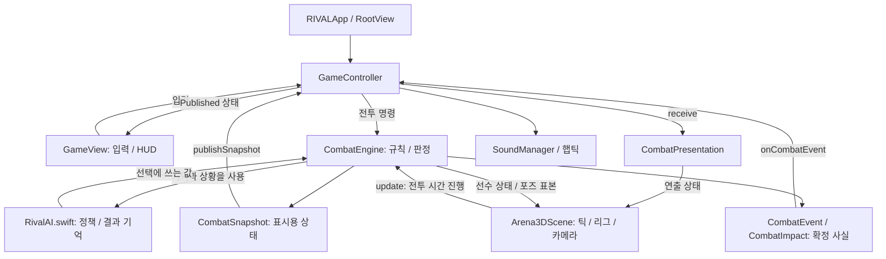

# RIVAL iOS 아키텍처

현행 소스 **1.2(6)**의 탐색 지도입니다. 파일의 책임과 데이터 흐름을 설명하며, 앱 실행·테스트 통과·출시 승인을 보증하지 않습니다.

## 진입점과 책임

| 관심 영역 | 먼저 읽을 소스 | 책임 |
| --- | --- | --- |
| 앱과 화면 전환 | [PixelBoxingApp.swift](../../ios-pixel-boxing/PixelBoxingIOS/PixelBoxingApp.swift#L1) | `RIVALApp` → `RootView`, 일반·스토리 컨트롤러와 화면 상태 |
| 입력과 연결 | [GameController.swift](../../ios-pixel-boxing/PixelBoxingIOS/GameController.swift#L1), [CombatInput.swift](../../ios-pixel-boxing/PixelBoxingIOS/CombatInput.swift#L1) | 입력 전달, 스냅샷 게시, 이벤트 처리, 저장·피드백 연결 |
| 전투 규칙 | [CombatCore.swift](../../ios-pixel-boxing/PixelBoxingIOS/CombatCore.swift#L1) | `CombatEngine`, 공격·접촉·피해·스태미나·회피·라운드 판정 |
| 상대 선택과 기억 | [RivalAI.swift](../../ios-pixel-boxing/PixelBoxingIOS/RivalAI.swift#L1) | 공격 결과 기억, 난도·학습 가중치와 전술 판단에 쓰는 값 타입 |
| 전투 UI | [GameView.swift](../../ios-pixel-boxing/PixelBoxingIOS/GameView.swift#L1) | 컨트롤러 상태를 표시하고 터치 입력을 전달 |
| 이벤트 연출 | [CombatPresentation.swift](../../ios-pixel-boxing/PixelBoxingIOS/CombatPresentation.swift#L1) | `CombatEvent`, `CombatImpact`, 시그니처와 일시적 충격·카메라 상태 |
| 3D 화면과 루프 | [Arena3DScene.swift](../../ios-pixel-boxing/PixelBoxingIOS/Arena3DScene.swift#L1) | SceneKit 리그·링·카메라, 디스플레이 틱의 전투·연출 갱신 순서 |
| 음향·촉각 | [SoundManager.swift](../../ios-pixel-boxing/PixelBoxingIOS/SoundManager.swift#L1), [ImpactFeedback.swift](../../ios-pixel-boxing/PixelBoxingIOS/ImpactFeedback.swift#L1) | 확정 이벤트와 장면 상태에 맞춘 피드백 |

## 규칙 → 스냅샷·이벤트 → 표현

- `CombatSnapshot`은 HUD에 게시하는 상태 복사본입니다. 접촉 순간의 피해·가드·카운터 사실은 `CombatEvent`로 별도 전달합니다.
- `GameController.handleCombatEvent`는 같은 확정 이벤트를 연출과 음향·햅틱에 연결합니다. HUD 값의 차이로 타격 사실을 재추정하지 않습니다.
- 실전 루프의 `Arena3DScene.update`는 연출 시간 진행, 유지 입력 동기화, `engine.update`, 시각 동기화와 스냅샷 게시를 조율합니다. 렌더러와 완전히 분리된 독립 엔진 루프가 있다는 뜻은 아닙니다.
- 규칙의 책임은 `CombatEngine`에 있습니다. 연출 전용 시간·카메라 효과를 피해, 무적, 입력 창이나 AI 가중치의 근거로 사용하지 않습니다.

## 포즈와 모션

| 소스 | 탐색 목적 |
| --- | --- |
| [FighterPose.swift](../../ios-pixel-boxing/PixelBoxingIOS/FighterPose.swift#L1) | 선수 포즈와 관절·글러브 위치를 다루는 공통 표현 |
| [BoxingMotion.swift](../../ios-pixel-boxing/PixelBoxingIOS/BoxingMotion.swift#L1) | 공격 모션의 시간과 궤적 |
| [DefensiveMotion.swift](../../ios-pixel-boxing/PixelBoxingIOS/DefensiveMotion.swift#L1) | 방어 동작의 자세와 이동 |
| [WeaveMotion.swift](../../ios-pixel-boxing/PixelBoxingIOS/WeaveMotion.swift#L1) | 위빙 모션의 자세 변화 |

접촉·회피를 바꿀 때는 엔진의 판정 경로와 포즈 표본을 함께 읽습니다. 외형 변경만으로 성공 판정을 추가하거나, 엔진 궤적과 리그 표현을 서로 다른 규칙으로 계산하지 않습니다.

## 모드와 외부 서비스

| 소스 | 책임과 경계 |
| --- | --- |
| [StoryMode.swift](../../ios-pixel-boxing/PixelBoxingIOS/StoryMode.swift#L1), [StoryViews.swift](../../ios-pixel-boxing/PixelBoxingIOS/StoryViews.swift#L1) | 상대·대결·진행 기록과 스토리 화면 흐름 |
| [StoryPurchaseStore.swift](../../ios-pixel-boxing/PixelBoxingIOS/StoryPurchaseStore.swift#L1) | StoreKit 검증에 따른 이용권, 구매·복원·기존 고객 판정 |
| [GameCenterManager.swift](../../ios-pixel-boxing/PixelBoxingIOS/GameCenterManager.swift#L1) | Game Center 인증, 순위 조회·점수 제출 |

구매 권한과 승리로 얻는 보상은 별개입니다. DEBUG 스토리 체험은 실제 구매 검증이 아니며, 로컬 진행 기록은 서버 검증형 안티치트 증명이 아닙니다. 상세 경계는 [보안 문서](SECURITY_BOUNDARIES.md#L1)를 따릅니다.

## 테스트 위치

- [../../ios-pixel-boxing/PixelBoxingIOSTests](../../ios-pixel-boxing/PixelBoxingIOSTests): 전투·방어·AI·모션·연출 등의 단위 테스트 소스.
- [../../ios-pixel-boxing/PixelBoxingIOSUITests](../../ios-pixel-boxing/PixelBoxingIOSUITests): UI 시나리오와 로컬 StoreKit fixture. 폴더명과 Xcode 타깃 표시명은 별개입니다.

테스트가 존재한다는 사실과 최신 소스에서 실행해 통과했다는 사실을 구분합니다. 이 문서 작업에서는 실행하지 않습니다.

## 유지해야 할 계약

- 한 라운드의 학습 기반 선택 정책은 고정하고 관찰 결과는 라운드 종료 후 다음 정책에 반영합니다. 거리·스태미나·보이는 공격에 대한 상황 반응은 실시간 학습과 구분합니다. [AI 안내](AI_USAGE.md#L1) 참조.
- 현행 앱 소스·테스트·리소스는 `ios-pixel-boxing/`에 유지합니다. 레거시 정리를 이유로 앱 경로를 다시 옮기지 않습니다.
- 기준 프로젝트는 [RIVAL.xcodeproj](../../ios-pixel-boxing/RIVAL.xcodeproj/project.pbxproj#L1)입니다. [project.yml](../../ios-pixel-boxing/project.yml#L1)은 별도 관리되는 생성 입력이며, 문서 정리에서 Xcode 프로젝트를 재생성하지 않습니다.
- 앱 리소스, Story 모션, 제작 스크립트, 스크린샷·메타데이터 경로도 유지합니다. 세부 배치는 [저장소 안내](../REPOSITORY_LAYOUT.md#L1)에 있습니다.
