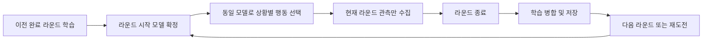

# RIVAL 개발 고민과 문제 해결 기록

> 작성 기준일: 2026-10-12
> 대상: iOS RIVAL의 개발 대화, 저장소 기록, 현재 작업 트리
> 현재 프로젝트 설정: 마케팅 버전 1.2, 빌드 6. 배포된 바이너리의 버전 확인과는 다르다.

## 1. 기록의 목적과 읽는 방법

이 문서는 기능 목록이 아니라 **개발자가 어떤 문제를 발견했고, 왜 특정 해결 방법을
선택했으며, 그 결과를 어디까지 확인했는지**를 남기는 개발 회고다. RIVAL은 개인
프로젝트이며, 아래 내용은 개발자가 요구와 판단을 제시하고 GitHub Copilot과 함께
분석·구현을 반복한 과정이다. AI가 작성한 초안이나 수정 보고를 개발자의 독자적인
측정 결과로 바꾸어 서술하지 않는다.

기록은 다음 근거를 구분한다.

| 근거 수준 | 의미 | 주의할 점 |
| --- | --- | --- |
| 사용자 발언 | 개발자가 직접 보고한 문제, 요구, 실기기 체감 | 한 번의 체감을 모든 기기의 성능으로 일반화하지 않는다. |
| 당시 작업 기록 | 대화에 남은 분석과 수정 내역 | 후속 수정으로 현재 코드와 달라질 수 있다. |
| 현재 코드 | 작성일에 존재하는 상태·수식·호출 경로 | 코드 존재만으로 실기기 동작·원인·성과를 입증하지 않는다. |
| 기존 검증 기록 | 기존 문서에 날짜와 범위가 붙은 실행 결과 | 이번 변경 전체를 검증한 결과로 재사용하지 않는다. |
| 미확인 | 원인 또는 결과를 확정할 자료가 부족한 항목 | 추측을 성과로 쓰지 않고 남은 확인 사항으로 기록한다. |

이번 문서 작성에서 앱 빌드, 설치, 테스트 실행, 성능 프로파일링, 스토어 배포 조회는
하지 않았다. 현재 코드와 과거 대화의 사실을 대조하는 작업이다.

### 사례 안내

| 절 | 고민 또는 문제 | 결과를 읽을 때의 기준 |
| --- | --- | --- |
| 2 | 라운드 안에서 계속 학습하는 AI가 제품 의도에 맞는가 | 종료 학습 구조 확인, 장기 체감 미확인 |
| 3 | 크로스가 거의 맞지 않음 | 당시 사용자 확인, 이후 고정 조준 경로로 변경 |
| 4 | Blender 도입과 절차적 전신 모션 개선 | 현재 절차적 구현, 전환 비교 실험 없음 |
| 5 | 화면 동작·타격·회피의 시간이 따로 움직임 | 공유 포즈·시간·접촉 경로 확인 |
| 6 | 카운터 기회가 너무 드물고 위빙 보상이 약함 | 당시 회피 사용자 확인, 두 회피 난도는 동일하지 않음 |
| 7 | 모션 개선 뒤 랙 체감 | 당시 사용자 개선 확인, FPS·프로파일 수치 없음 |
| 8 | 느린 스태미나 회복과 전체 사거리 확장 | 수치·공유 경로 확인, 최종 밸런스 미확인 |
| 9 | 공격 횟수만 기억하는 AI의 한계 | 결과 분류·완료 라운드 병합 확인, RL과 구분 |
| 10 | 누적된 미사용 코드와 오래된 설명 | 참조 기반 정리, 일부 기존 테스트 기대값은 별도 과제 |
| 11 | 상대들이 쉬우며 전술 차이가 약함 | 카운터형 일부 체감 확인, 나머지는 구현 근거 |
| 12 | 강타형 회복 설계가 무한 가드로 이어짐 | 사용자 후속 확인, 모든 상황 보장 아님 |
| 13 | 도전인데 인트로가 요약됨 | 시청 이력 대신 진입 의도 전달 |
| 14 | 저장 재개와 새 라운드 시작이 혼동됨 | 체크포인트·학습 1회 병합 구조 확인 |
| 15 | 무료 전환·미구매 보상·기존 구매자 보호 | 권한 조건 확인, 실결제·기존 계정 검증 미확인 |
| 16 | 개발용 해금으로 실제 기록이 오염될 위험 | Debug/Release·별도 저장소 분리 확인 |
| 17 | 버전·구현·검증 기록이 서로 달라짐 | 문서와 산출물의 기준을 구분 |
| 18 | AI 기술 이름보다 제품 목표가 중요한 이유 | 현재 방식과 역사적 RL 구현을 구분 |
| 21 | 목록의 빈 영역을 눌러도 상대가 선택되지 않음 | 보존된 Release 캡처 결과, 로컬 StoreKitTest 범위 |
| 22 | 벨트 글자가 금속판 밖으로 튀어나옴 | 첫 수정 실패 뒤 메시를 인쇄 텍스처로 교체, 최종 외형 승인 미확인 |
| 23 | 이동 습관을 기록해도 상대가 거의 움직이지 않음 | 기록·판단·실행 연결, 당시 검사 보고와 현재 체감을 구분 |
| 24 | 장기 습관은 어디에 남고 업데이트에서 어떻게 보존되는가 | 로컬 저장 책임·누락 키 기본값 확인, 손상 복구와 구분 |

### 문서 간 기준 차이

[README](README.md), [게임 가이드](GAME_GUIDE.md), [AI 활용 문서](AI_USAGE.md),
[강화학습 감사](RIVAL_REINFORCEMENT_LEARNING_AUDIT.md)는 2026-10-12에 현재
1.2(6)의 회피·사거리·라운드 종료 학습·스토리 기준으로 최신화했다. 날짜가 붙은
과거 검증과 제출 PDF는 당시 기록으로 보존하며 현재 변경 전체의 검증으로 취급하지 않는다.
심사 제출 상태는 10월 11일의 보존 기록이며 이번 정리에서 다시 조회하지 않았다.

## 2. 핵심 판단: 라운드 안에서 강해지는 AI가 맞는가

### 문제를 발견한 계기

공격 결과를 이용해 대응을 개선하는 과정에서, 같은 라운드의 명중·가드·회피 결과가
즉시 다음 행동의 가중치를 바꾸는 구현이 추가됐다. 개발자는 다음과 같이 방향을 바로잡았다.

> 한 라운드 안에서는 동일한 난이도로 진행되고 라운드가 끝나고 학습해야
> 라운드가 진행될수록 플레이어를 학습해서 점차 강해지는 AI 컨셉이 유지되는건데?

핵심은 적응 능력이 많을수록 무조건 좋은 AI가 아니라는 점이었다. 라운드 중 계속
학습하면 방금 발견한 공략이 같은 라운드 안에서 약해질 수 있고, 라운드 사이에 전술을
바꾸며 성장한다는 경험과 어긋난다. 이는 구현상의 오탈자가 아니라 **학습 시점과
플레이어 경험의 계약이 어긋난 문제**였다.

### 당시 원인 분석

새 공격 결과 기록이 매 판단의 가중치 계산에 곧바로 들어가고 있었다. 기존에도
`RecentHabitMemory`의 최근 공격·감쇠 표본이 전술 읽기를 갱신하고, 최근 위빙 횟수가
바디 공격 가중치에 영향을 주는 경로가 있었다. 결과 기록 하나만 바꾸어서는 라운드
내 학습을 막을 수 없었다.

### 해결 방법

1. `roundHabits`, `roundPlayerAttackResults`, `roundRivalAttackResults`를 현재 라운드의 수집본으로 분리했다.
2. 행동 선택은 이전에 완료된 라운드에서 확정된 `habits`, `playerAttackResults`, `rivalAttackResults`만 읽도록 했다.
3. `tacticalRead`는 라운드 시작 시 확정된 습관에서 설정하고 경기 중 학습 때문에 갱신하지 않도록 했다.
4. 승리·패배·무승부 모두 라운드 종료 시 수집본을 확정 모델에 병합하고 저장했다.
5. 실시간 최근 습관과 위빙 가중치 경로를 제거하고, 후속 정리에서 사용되지 않는 타입·카운터·전용 검사도 삭제했다.



거리·스태미나·눈에 보이는 공격·직전 타격 결과에 대응하는 고정 규칙은 유지한다.
**학습 모델이 고정된다는 뜻은 매번 같은 행동을 한다는 뜻이 아니다.** 상황과 난수에
따라 선택은 달라지지만, 경기 중 모은 통계로 플레이어에 대한 모델을 새로 학습하지 않는다.

### 저장과 종료 순서

장기 저장의 필요성은 더 이른 2026-09-06 대화에서도 명확히 제기됐다. 당시 한 수정은
승리한 라운드만 장기 프로필에 넣도록 했지만, 개발자는 다음 기준으로 바로잡았다.

> 플레이어의 장기적인 습관 저장과 반영은 무조건적으로 있어야해

그래서 패배·무승부의 완료 라운드도 저장 대상으로 바뀌었다. 실패한 전략도 반복
습관이라는 제품 기준이다. 이후 2026-10-10에는 라운드 내부 학습까지 제거했으므로,
과거의 "승리 라운드만 장기 저장, 최근 전술은 경기 중 즉시 반영"을 현재 정책으로
설명하면 두 번의 판단 변경을 모두 놓치게 된다. 중단된 미완료 라운드까지 언제나
일반 RIVAL 장기 기억에 병합한다는 뜻은 아니다.

기존 `pixelBoxingHabitMemory` 형식은 유지하고, 공격 결과는
`pixelBoxingRivalResults`에 `RivalLearningProfile`로 별도 저장했다. 새 결과 프로필이
없어도 기존 습관을 복원할 수 있게 했으며 학습 초기화 시 두 저장 키를 함께 삭제한다.

KO 타격은 결과를 먼저 라운드 수집본에 기록한 다음 종료 학습을 수행하도록 정리했다.
종료부터 실행하면 승부를 결정한 마지막 공격 결과가 학습에 빠질 수 있기 때문이다.

### 현재 상태와 한계

일반 RIVAL 경로는 완료 라운드에서 학습을 확정한다. 현재 스토리에는
`commitStoryRoundLearning`이라는 별도 종료 병합 경로도 있다. 두 모드의 저장과
진행은 구분해야 한다. 후속 스토리의 고정 상대 정책을 일반 RIVAL의 점진 학습과
같은 것으로 설명하지 않는다.

당시 구문·에디터 진단은 확인했지만, 이 변경 뒤 일반 AI의 장기 체감이 성공했다는
사용자 확인은 별도로 확보되지 않았다. 일부 기존 테스트는 라운드 중 전술 읽기를
기대하는 오래된 단언을 포함하므로 현재 학습 정책의 검증 증거로 삼을 수 없다.

근거: [CombatCore.swift](PixelBoxingIOS/CombatCore.swift)의 `startRound`, `enemyActionWeights`,
`finishRound`, `commitStoryRoundLearning`, `saveHabits`;
[RivalAI.swift](PixelBoxingIOS/RivalAI.swift)의 `RivalAttackMemory`, `RivalLearningProfile`.

## 3. 크로스가 거의 맞지 않는 문제

### 문제와 당시 가설

개발자는 “크로스가 아예 안맞는데?”라고 보고했다. 당시 공격은 시작할 때 상대
표면에 대한 조준점과 방향을 고정했다. 크로스는 잽보다 준비가 길고 판정 각도가
좁으므로 상대가 준비 중 이동하면 고정된 조준점이 실제 표적에서 벗어날 수 있었다.
이는 당시 코드에서 찾은 수정 가설이며, 모든 크로스 미스의 단일 원인을 측정으로
확정한 것은 아니다.

### 당시 해결

크로스의 `deliveryStart`인 0.06초까지는 방향과 조준점을 갱신하고, 실제 주먹이
나가기 시작한 뒤에는 고정하도록 바꿨다. 공격 내내 상대를 따라가는 유도 펀치로
만드는 대신, 준비 구간에서만 오래된 조준점을 보정하는 제한된 변경이었다.

개발자는 이후 다음과 같이 실기기 체감을 확인했다.

> 크로스 적용 됐고 회피 판정도 됐어 렉도 없어졌고

이 발언은 당시 크로스·회피·지연 개선을 개발자가 체감했다는 근거다. 적중률 수치나
모든 스타일·기종에서의 검증을 뜻하지 않는다.

### 후속 수정과 현재 코드의 차이

이후 개발자는 상대가 옆으로 이동할 때 다음 문제를 보고했다.

> 팔이 이상하게 꺾이면서 상대방 쪽으로 향하는 움직임이 보여

시선과 공격선이 고정된 것처럼 보이는데 팔의 조준이 상대를 따라가면, 회피한 상대를
주먹만 추적하는 듯한 동작이 된다. 당시 수정 보고는 공격 시작 때 방향과 조준점을
함께 확정하고 공격이 끝날 때까지 유지하는 것이었다. 앞선 크로스 준비 재조준도
제거한 이유는 적중을 늘리는 것보다 **보이는 공격선과 피할 수 있는 규칙을 일치시키는
것**을 우선했기 때문이다. 이 후속 수정 뒤 팔 꺾임이 해결됐다는 실기기 확인은
확보하지 못했다.

2026-10-12 현재 `isAligningCross`, `alignCrossWindup` 정의는 남아 있지만, 확인한
공격 중 방향 갱신 경로에서는 호출되지 않는다. 현재는 공격 시작 전에 방향을
정렬하고 조준점을 고정하며, 공격 도중 `updateFacing`은 방향을 갱신하지 않는 구조다.

따라서 **“준비 0.06초 동안 재조준하는 기능이 지금도 켜져 있다”라고 설명하면 안 된다.**
당시 성공한 수정 이력과 후속 고정 조준 설계는 분리해 기록한다. 현재 경로에서 같은
체감 문제가 다시 나타나는지는 이번 문서 작성으로 확인하지 않았다.

근거: [CombatCore.swift](PixelBoxingIOS/CombatCore.swift)의 `executeAttack`, `updateFacing`,
`FighterModel.isAligningCross`;
[BoxingMotion.swift](PixelBoxingIOS/BoxingMotion.swift)의 `begin`, `aim`, `alignCrossWindup`.

## 4. Blender로 바꿀 것인가, 현재 모션의 원리를 개선할 것인가

### 고민의 배경

개발 과정에서 Blender를 이용한 캐릭터·애니메이션 제작과 현재 절차적 모션의 개선을
논의했다. 실제 작업은 외부 스키닝 캐릭터로 즉시 교체하기보다, 승인된 복서·링의
외형을 유지하면서 기존 SceneKit 관절형 리그를 개선하는 방향으로 진행됐다.

현재 캐릭터는 캡슐·구·박스와 관절 노드로 구성되며, `FightPose`가 매 프레임 관절
위치와 회전을 계산한다. 이 구조에서는 공격·더킹·위빙·피격 자세를 전투 상태와
연결하기 쉽지만, 여러 관절의 힘 전달을 직접 설계해야 한다. Blender로 옮기면
자동으로 타격 판정과 모션의 일치 문제가 해결되는 것은 아니다.

### 실제로 제기된 문제

개발자는 훅에 대해 다음과 같이 지적했다.

> 훅을 할때 너무 팔만 휘두르는 느낌인데 훅은 원래 허리까지 돌리면서 팔을 같이 휘두르는거 알아?

이 문제는 팔의 궤적만 자연스럽게 만들어서는 해결하기 어렵다. 발 피벗과 골반 회전,
가슴·어깨 회전이 공격의 방향과 시간차를 갖고 이어져야 전신으로 치는 동작이 된다.

### 해결 구조

`PunchMotion`에 발·골반·몸통·어깨의 서로 다른 로딩·타격 진행을 두고, 훅·바디·어퍼컷은
왼손과 오른손에 다른 부호를 사용해 준비 회전과 타격 회전을 연결했다. 바디샷에는
낮은 준비 자세에서 복부로 상승하는 궤적을 적용하고, 어퍼컷·훅은 각 공격에 맞는
곡선 궤적을 사용했다. 반대쪽 손의 방어 자세, 회수 때의 복귀, 더킹·위빙 진입 자세도
공격 포즈에 연결했다.

팔을 길게 늘려 표적에 맞추는 방식은 피했다. `TwoBoneLimb.solve`가 두 관절의 길이로
도달 범위를 제한하고, 팔 길이는 상완 0.40·전완과 커프를 포함한 하부 0.58로 유지한다.
스타일별 굵기와 길이를 구분하여 체격 차이가 공격 중 팔 길이 변화로 나타나지 않게 했다.
발은 앞쪽 접지점을 기준으로 회전시키고, 다리 지지 보정은 작은 무릎 굽힘으로 제한했다.

### 선택의 의미와 한계

이는 “Blender가 나빠서 쓰지 않았다”는 판단이 아니다. 이미 승인된 외형과 판정 구조를
유지한 상태에서, 문제가 발생한 전신 회전·지지·복귀를 직접 고치는 선택이었다.
외부 애니메이션 전환의 제작비·시간·성능을 비교 측정한 자료는 없다.

현재 코드에 전신 회전과 고정 길이 IK가 있다는 점은 확인된다. 모든 공격이 복싱
전문가 기준으로 정확하거나 실기기에서 모두 자연스럽다는 결론은 별도 검증이 필요하다.

근거: [BoxingMotion.swift](PixelBoxingIOS/BoxingMotion.swift)의 `PunchMotion`, `CurvedPunchMotion`,
`BodyShovelMotion`, `applyPowerPunch`, `TwoBoneLimb`, `resolveStraightPunch`;
[FighterPose.swift](PixelBoxingIOS/FighterPose.swift);
[DefensiveMotion.swift](PixelBoxingIOS/DefensiveMotion.swift)의 `pivotedFoot`.

## 5. 보이는 동작과 실제 타격·회피 판정의 책임을 맞추기

### 문제의 성격

모션 개선은 렌더링 함수의 문제로만 보이기 쉽지만, 화면에서 숙였는데 맞거나 장갑이
지나갔는데 맞지 않는다면 전투 규칙에 대한 신뢰까지 손상된다. 공격 궤적·방어 자세·
판정 시각이 따로 계산되면 한쪽만 수정할 때 불일치가 커질 수 있다.

### 움직이는 아웃복서가 유독 잘 맞지 않았던 사례

개발자는 다음과 같이 상대별 체감 문제를 제기했다.

> 아웃복서 상대로 공격이 너무 안맞는거 같은데 판정 부분 분석해봐

당시 분석에서는 상대 전용 무적이나 작은 피격 반경보다, 공격이 `activeStart`를
넘는 순간에만 검사하는 경로를 원인 후보로 보았다. 첫 판정 시점에 장갑이 표적과
겹치지 않아도 활성 구간 중 표적이 장갑 궤적에 들어올 수 있다. 한 시점의 실패로
공격 전체를 확정하면 횡이동이 많은 상대에서 이후의 접촉을 놓칠 수 있었다.
이는 소스에서 찾은 가설이며, 아웃복서의 미스율을 측정해 원인 비율을 확정한 것은 아니다.

피격 반경을 확대하거나 공격이 상대를 계속 따라가게 하는 대신 **합법적인 활성
구간에서 접촉을 다시 찾는 것**을 선택했다. `prepareContact`가 이전·현재 프레임을
준비하고, `sweptContact`가 그 사이 장갑과 표적의 궤적을 검사하며,
`evaluateContact`가 접촉과 방향 회피의 시각을 비교하도록 했다. 방어는 뒤늦게
바뀐 현재 상태만으로 일괄 처리하지 않고 접촉 프레임의 상태를 함께 사용한다.

`updateFighter`는 아직 활성 구간이 남아 있는 단순 미스를 즉시 확정하지 않지만,
명중·가드·성공 회피는 해당 공격의 결과로 한 번 확정한다. 따라서 구간 검사를
여러 번 하더라도 같은 공격이 여러 번 피해를 주거나 학습 표본을 늘리는 방식은 아니다.
공격의 `serial`도 확인해 피격으로 취소되거나 교체된 공격의 이전 접촉을 적용하지 않는다.

### 해결 과정

공격의 준비·전달·접촉·후속·회수 시간을 `AttackSpec`에 두고 공유 모션에서 사용했다.
`PunchContactGeometry`가 진입 자세·조준점·장갑 위치·상대의 머리 또는 몸통 표적을
계산하도록 하여 판정과 렌더러가 공통 포즈 계산을 사용하게 했다.

방어 시간과 이동은 양 선수의 타격 검사 전에 갱신하도록 정리했다. 피격으로 취소된
공격·위빙의 자세는 짧은 `FighterPoseTransition`으로 이어, 상태 변경이 곧바로
중립 자세로 튀는 현상을 줄이도록 했다. 명중·헛침 뒤 회수의 느낌도 구분하되 기본
공격 종료 시각을 넘어 별도의 행동 시간을 임의로 더하지 않도록 구성했다.

슬로모션 중에는 카운터 창·동작처럼 시뮬레이션 시간으로 움직여야 할 것과, 연출
지속처럼 실제 경과시간으로 움직여야 할 것을 구분했다. 두 시간을 섞으면 슬로모션
자체가 반격 기회를 소모하거나 마지막 프레임에서 속도가 갑자기 바뀔 수 있다.

### 현재 상태

현재 접촉 경로는 당시의 단일 시점 검사에서 추가로 발전해, 활성 시간 구간을 나눠
장갑의 이동과 방어 구간을 검사하는 `sweptContact`·`evaluateContact` 구조를 포함한다.
따라서 오래된 문서의 “활성 시작 한 번만 검사”를 현재 구현의 전부로 설명하지 않는다.

공통 함수를 쓰는 것이 화면과 판정의 완전 일치를 보장하지는 않는다. 렌더러에는
대기 모션·월드 지지발·피격 연출 보정이 추가된다. 장갑 메시 전체의 물리 충돌
시뮬레이션도 아니므로, 가장자리 접촉·빠른 표적 이동의 체감은 별도 확인 대상이다.
당시 이 수정에 대한 소스 컴파일 보고는 있으나 아웃복서 적중 개선을 개발자가
다시 확인한 발언은 확보하지 못했다. 3절의 더 이른 크로스 체감 확인을 이 접촉
구간 변경의 성공 증거로 재사용하지 않는다.

근거: [CombatCore.swift](PixelBoxingIOS/CombatCore.swift)의 `AttackSpec`, `updateFighter`,
`prepareContact`, `evaluateContact`;
[BoxingMotion.swift](PixelBoxingIOS/BoxingMotion.swift)의 `PunchContactGeometry`, `sweptContact`,
`PunchRecoveryMotion`;
[FighterPose.swift](PixelBoxingIOS/FighterPose.swift)의 `FighterPoseTransition`.

## 6. 회피해도 카운터 타이밍이 거의 나타나지 않는 문제

### 사용자 피드백

개발자는 카운터 슬로모션이 사라졌는지 질문한 뒤 “지금 너무 카운터 타이밍이 안뜬다”고
보고했다. 이후에는 위빙에도 더킹과 비슷한 회피 성공 판정과 보상을 요청했다.
단순히 표시를 더 자주 띄우는 것이 아니라, 성공 판정·등급 평가·실제 반격 기회를
함께 조정해야 하는 문제였다.

### 원인 가설과 보정

더킹은 입력 직후 완전히 낮아지는 것이 아니라 진입 시간을 갖는다. 그런데 충분히
낮아져야 회피가 인정되는 조건과 입력 이후 전체 시간을 사용하는 등급 조건이
겹치면, 적절한 입력이 상위 등급으로 평가되기 어려울 수 있다.

최소 회피량을 기존 85%에서 70%로 완화하고, 등급 평가에서 진입 시간 0.09초를
제외했다. 판정에서는 실제 접촉과 원래 위협을 구분했다. 단지 멀리 떨어져 공격이
닿지 않은 것을 성공 회피로 보상하지 않고, 머리 공격의 위협과 방향 회피를 함께
확인하는 방향이었다.

현재 `DuckMotion.entryDuration = 0.09`, `minimumEvadeAmount = 0.70`이며, 중립에서
같은 방향으로 진입할 때 최소량 도달은 약 0.063초다. 위빙은 이 시작 기준을 공유하되
자체 시간창·측면 이동·훅 연계 조건을 유지한다.

### 보상 연결

더킹과 위빙의 성공 경로를 `rewardDodge`에 연결했다. 등급은 진입 시간을 제외한
입력 선행 시간이 0.12초 이하면 Perfect, 0.22초 이하면 Accurate, 0.36초 이하면 Good,
나머지는 Normal로 평가한다.

| 등급 | 카운터 입력 창 | 대표 연출 |
| --- | ---: | --- |
| Normal | 0.18초 | 일반 성공 피드백 |
| Good | 0.28초 | 짧은 약한 줌 |
| Accurate | 0.60초 | 0.40배 시간 진행과 강조 줌 |
| Perfect | 0.80초 | 0.20배 시간 진행과 강한 줌 |

창 안에서 시작한 공격은 `pendingDodgeCounter`로 입력 성공을 기억한다. 실제 접촉이
늦어져도 입력 사실을 잃지 않게 하는 구조다. 다만 노출 피해 배율과 피드백 플래그는
동일한 개념이 아니므로, 보상 표시를 곧바로 모든 상황의 추가 피해 보장으로 설명하지 않는다.

### 같은 보상과 같은 난도는 다르다

개발자가 두 회피의 난도가 같은지 확인했을 때, 시작 기준·등급·보상은 공유하지만
위빙은 한 번 실행되는 시간창과 이동 궤적을 갖고 더킹은 홀드와 자세를 사용한다는
차이를 구분했다. 둘 다 바디 공격을 방향 회피로 막지 못하며, 잘못된 방향은 실패한다.

앞의 실기기 확인 발언은 당시 회피 판정 개선의 근거다. 모든 공격군에서 성공률이
동일하거나 두 기술의 난도가 수치상 같다는 실험 결과는 없다.

근거: [DefensiveMotion.swift](PixelBoxingIOS/DefensiveMotion.swift)의 `DuckMotion`;
[Weaving.swift](PixelBoxingIOS/Weaving.swift)의 `WeaveState`;
[CombatCore.swift](PixelBoxingIOS/CombatCore.swift)의 `playerDodgeGrade`, `rewardDodge`, `DodgeGrade`.

## 7. 모션 개선 후 랙이 심해졌다는 체감

### 문제 제기

모션·판정 계산을 늘린 뒤 개발자는 스태미나 회복 개선과 함께 “랙이 좀 심해진거 같은데
원인 분석 해봐”라고 요청했다. 이는 개발자 실기기 체감이며, 해당 시점의 FPS나
CPU/GPU 프로파일 자료는 확보하지 않았다.

### 정적 분석에서 찾은 비용 후보

SceneKit 노드를 매 프레임 새로 만드는 구조가 아니더라도, 캡슐 높이나 재질 값을
계속 쓰면 추가 갱신 작업이 발생할 수 있다. 또한 중립 자세와 고정 해부학을 반복
계산하거나, 같은 표적·장갑 접촉을 판정과 방향 계산에서 중복 산출하면 프레임 비용이
늘어난다. 새 모션 로직의 양과 매 프레임 실행 횟수를 함께 살폈다.

이들은 코드상 비용 후보이지, 실제 지연의 단일 원인을 프로파일러로 확정한 결과는 아니다.

### 적용한 개선

- 정지 자세를 `baseStances`·`styledStances`에 캐시했다.
- 스타일별 고정 해부학을 `restingAnatomies`에 두고 공격마다 재계산하지 않도록 했다.
- 숨겨진 소매 등 실제로 보이지 않는 구성요소의 불필요한 갱신을 줄였다.
- `BoneNode`에서 캡슐 높이는 이전 값과 차이가 0.0001을 넘을 때만 갱신하고, 굵기 배율은 변경 시에만 썼다.
- 피격·노출 발광의 재질 값은 상태가 바뀔 때만 쓰도록 했다.
- AI 판단에서 공통 머리·몸통 표적과 진입 자세를 재사용하고, 이미 계산한 접촉점을 방향 계산에 전달했다.

해상도·캐릭터 외형·공격 횟수를 무조건 줄이는 방식이 아니라, 같은 결과를 만드는
중복 계산과 변화 없는 쓰기를 줄이는 방식이었다. 접근성의 동작 줄이기도 성능
다운그레이드 스위치로 임의 전용하지 않았다.

### 결과와 해석

개발자가 “렉도 없어졌고”라고 확인했다. 이는 당시 실기기에서 지연 체감이 개선됐다는
결과다. “FPS가 몇 배 상승”, “모든 기기 60fps 유지”, “캡슐 갱신이 병목의 전부”라는
주장을 뒷받침하는 측정은 없다. 이후 스토리·접촉 검사 변경으로 프레임 작업량도
바뀌었으므로 당시 확인을 현재 전체 앱 성능 보장으로 확대하지 않는다.

근거: [Arena3DScene.swift](PixelBoxingIOS/Arena3DScene.swift)의 `BoneNode`, `BoxerRig.update`;
[FighterPose.swift](PixelBoxingIOS/FighterPose.swift)의 `baseStances`, `styledStances`;
[BoxingMotion.swift](PixelBoxingIOS/BoxingMotion.swift)의 `StraightPunchAnatomy`, `direction`;
[CombatCore.swift](PixelBoxingIOS/CombatCore.swift)의 `enemyActionWeights`.

## 8. 스태미나 회복과 전체 공격 사거리의 체감 조정

### 스태미나 회복

개발자는 회복 속도를 높여 달라고 요청했다. 일반 회복 상수를 초당 8.5에서 11로
변경하고, 공격 비용·탈진 시간·가드 피격 비용은 유지했다. 수식상 약 29.4% 높은
회복률이지만, 이는 전투 승률이나 플레이 만족도가 29.4% 개선됐다는 뜻이 아니다.

회복 조건은 그대로 중요하다. 현재 일반 경로는 탈진 종료·비공격·더킹 없음·위빙
비활성에서 회복하며 일반 가드 중에는 회복하지 않는다. 연습 모드는 스태미나를
100으로 유지한다. 스토리 강타형의 전용 회복은 별도 규칙이므로 일반 상수와 구분한다.

### 전체 사거리 증가

개발자는 “전체적으로 공격 사거리 늘릴수 없나?”라고 요청했다. 각 공격의 기본
사거리를 일괄 덮어쓰기보다, 모든 펀치와 스타일에 공통인 `punchReachExtension`을
8에서 14 게임 단위로 늘렸다.

기본 거리 제한은 다음과 같다.

```text
선수 중심 간 거리 제한
    = 기본 펀치 사거리 × 스타일 리치 배율
    + 공통 연장 14
    + 표적 표면 반경 / sceneScale
    + 선수별 punchReachBonus (스토리 강타형 4, 나머지 0)

sceneScale = 0.025
```

잽이 가장 길고 훅·어퍼컷이 짧은 차이는 유지되며, 공통 연장 변화는 6 게임 단위다.
실전·연습·AI의 거리 판단과 공유 조준 계산이 같은 값을 사용한다. 몸통 전진은 같은
상수를 씬 단위로 환산하며, 팔 길이나 글러브 크기를 늘리지 않는다.

### 중요한 예외

거리 제한은 **실제 적중 보장 거리**가 아니다. 각도·방어·움직인 표적·고정 길이 IK와
장갑 접촉까지 만족해야 적중한다. 특히 현재 스토리 강타형은 별도로 리치 +4를 갖고
있으므로 공통 증가와 전용 상대 설정을 혼동하지 않는다.

당시 구문·에디터 확인은 했지만, 사거리 확대 후 모든 스타일·펀치의 실제 적중 한계나
밸런스에 대한 사용자 확인은 기록되지 않았다.

근거: [CombatCore.swift](PixelBoxingIOS/CombatCore.swift)의 `staminaRecoveryPerSecond`,
`punchReachExtension`, `hitRange`, `advanceFighter`;
[BoxingMotion.swift](PixelBoxingIOS/BoxingMotion.swift)의 `contactReach`, `aim`, `extendChestForPunch`.

## 9. 공격을 자주 쓰는 것과 잘 맞히는 것은 다르다

### 개선하려던 한계

기존 습관 기억은 사용 횟수와 행동 비율이 중심이었다. 자주 쓴 공격이 실제로 잘
맞는지, 가드에 막히는지, 거리 때문에 빗나가는지를 구분하지 않으면 유효한 전술과
비효율적인 반복을 같은 종류의 습관으로 볼 수 있다.

### 결과의 분류

`RivalAttackOutcome`에 명중, 가드, 더킹·위빙·백스텝 회피, 거리·각도·접촉 실패,
판정 불가를 구분했다. 실제 접촉 시도에 대한 결과를 기록하고, 피격으로 접촉 전에
취소된 공격을 무조건 거리 실패로 만들어 학습하지 않도록 했다. 판정 불가 결과는
유효한 학습 표본에서 제외했다.

`RivalAttackMemory`는 최근 최대 32건의 기록을 유지하고, 오래된 기록의 영향은
0.94씩 줄인다. 표본량에 따른 내부 신뢰도와 결과 비율로 가중치를 보정한다. 예를
들어 머리 공격이 가드·회피에 막히면 바디 선택을 높이고, 거리 실패에는 접근,
각도 실패에는 서클링을 더한다. 개별 공격 보정에는 하한·상한을 두었다.

### 시행착오와 경계

처음 구현은 현재 라운드의 결과를 즉시 이용해 2절의 제품 의도와 충돌했다.
결과를 구분하는 기능은 유지하되, **수집과 학습 반영의 시점을 분리하는 것**이
최종 해결이었다. 직전 명중 후 연타·빗나감 후 접근 같은 고정 상황 규칙과 누적
학습은 별개다.

이 결과 기반 보정도 보상으로 Q값이나 신경망을 갱신하는 강화학습은 아니다.
미리 작성한 대응 규칙의 입력을 공격 횟수에서 실제 결과까지 확장한 통계 기반
적응이다. 내부 신뢰도를 실제 학습 정확도로 표시하거나 검증된 확률로 주장하지 않는다.

근거: [RivalAI.swift](PixelBoxingIOS/RivalAI.swift)의 `RivalAttackOutcome`, `RivalAttackMemory`,
`adjustWeights`, `recoveryChoice`;
[CombatCore.swift](PixelBoxingIOS/CombatCore.swift)의 `updateFighter`, `planEnemyRecovery`.

## 10. 누적 수정 뒤 필요 없는 코드를 안전하게 정리하기

### 요청과 위험

개발자는 전체 코드파일을 분석해 필요 없는 코드를 삭제하라고 요청했다. 단순히
텍스트 검색에 호출이 없다는 이유로 지우면 SDK 콜백, `@objc` 타이머, SwiftUI
생명주기, 저장 모델, 독립 실행 스크립트까지 손상시킬 수 있었다.

### 정리 원칙과 실제 변경

앱·테스트·스크립트·프로젝트 연결을 함께 확인하고, 실제 소비자가 없는 코드만
정리했다. 당시 유지 코드 범위는 Swift 44개와 shell 4개였으며 앱 Swift는 28개였다.
이는 당시 수량이지 스토리가 추가된 현재 소스 전체 수량이 아니다.

- 폐기된 라운드 중 `RecentHabitMemory`와 위빙 카운터·감쇠 연산을 제거했다.
- 읽히지 않는 `colorName`, `whiffed`, `StraightPunchConstraint.weight`를 제거했다.
- 미호출 이동·렌더링 보조 함수, 레거시 사운드 진입점, UI 자리표시자와 선택 칩을 제거했다.
- 실제 진입 경로에 없는 경기 소개 UI와 그 전용 지역화·설명 함수를 제거했다.
- 연습장에서 읽지 않는 의상 전달 인자·게시 스태미나 값과 함수의 미사용 인자를 정리했다.
- 바뀐 생성자·함수 호출부를 함께 수정하고, 폐기된 기능만 검사하던 테스트·프로브 부분을 제거했다.

실제 이벤트·버퍼·캐시와 저장 호환성을 위한 필드는 보존했다. 예를 들어 별도 KO
사운드 메서드는 미사용이어도 KO 버퍼는 현재 타격 사운드 경로에서 쓰이므로 남겼다.
테스트 파일 이름이 `PlaceholderTests`여도 실질적인 회귀 검사가 있으므로 파일을
통째로 삭제하지 않았다.

### 확인과 남은 과제

당시 Swift 44개·shell 4개의 구문 확인과 에디터 진단을 통과했다. 타입 검사·앱
빌드·테스트 실행을 했다는 뜻은 아니다. 기존 테스트 중 라운드 중 읽기·이전 공격
시간·과거 백스텝 동작을 기대하는 부분은 후속 정합성 점검이 필요하다.

현재 크로스 보조 함수처럼 후속 수정으로 다시 미사용 상태가 된 코드도 있다.
따라서 한 번의 삭제 정리를 “앞으로 불필요한 코드가 전혀 없다”는 보증으로 삼지 않는다.

근거: [CombatCore.swift](PixelBoxingIOS/CombatCore.swift), [BoxingMotion.swift](PixelBoxingIOS/BoxingMotion.swift),
[Arena3DScene.swift](PixelBoxingIOS/Arena3DScene.swift), [SoundManager.swift](PixelBoxingIOS/SoundManager.swift),
[PlaceholderTests.swift](PixelBoxingIOSTests/PlaceholderTests.swift).

## 11. 상대별 난도를 숫자보다 전술로 구분하기

### 실제 고민

스토리 상대가 너무 쉽다는 피드백 뒤 개발자는 연타 횟수·전진 스텝·횡이동을
늘리면 난도가 어떻게 달라지는지 물었다. 핵심은 행동 빈도만 높여 모든 상대가
비슷해지는 것이 아니라, 각 상대가 다른 공략을 요구하도록 만드는 일이었다.

앞의 네 상대는 고정 전술, 최종 RIVAL은 학습 기반 대응을 사용한다. 일반 RIVAL의
라운드 상승과 스토리 상대별 특성을 구분한다. 일반 `RivalDifficulty`는 HP·피해·리치
버프를 사용하지 않지만, 개발자가 별도로 요청한 스토리 강타형에는 HP120·리치+4·
공격력1.15배라는 명시적 예외가 있다. 이를 숨겨진 일반 난도 상승으로 설명하면 안 된다.

### 카운터형: 회피 선택은 있는데 실제로 피하지 못함

개발자는 “전혀 더킹이나 위빙을 사용하지 않고 있어서 플레이 난이도가 너무 쉬워”라고
보고했다. 당시 분석 보고는 잽 활성 시작 0.08초에 대해 반응 시작이 0.075초여서
방어 자세가 준비될 시간이 부족하다고 설명했다. 확률만 늘리는 것으로는 반응이
실제 회피 성공으로 연결되지 않는 문제였다.

합법적인 준비 구간에서 더킹·위빙을 시도하고, 실제 회피 성공 뒤 반격 창과 기존
위빙 훅을 사용하도록 조정했다. 무조건 피하거나 미래 입력을 읽는 방식은 쓰지 않았다.
개발자는 이후 “카운터형은 바디를 치는게 핵심 공략이네”, “난이도 조절은 꽤 성공적인거
같은데”라고 확인했다. 이후 대치가 너무 수동적이지 않도록 8~12초 간격의 견제잽도 요청했다.

이 사례의 핵심 결과는 단순 난도 상승보다 **머리 회피가 강한 상대에게 바디를 써야
한다는 공략을 플레이어가 발견했다는 것**이다. 이후 견제잽 추가까지 동일한 체감으로
검증됐다는 뜻은 아니다.

### 견제형: 횡이동과 견제 공격의 연결

횡이동 방향이 반복되고 공격 중 이동이 멈추면, 움직이는 동안 공격하고 빠지는
견제형의 성격이 약해진다. 개발자는 불규칙한 방향과 횡이동 중 지속 견제를 요청했다.
방향을 구간마다 독립 선택하고, 잽·크로스 도중 실제 횡이동을 갱신하도록 했다.
최대 2타 뒤 0.18~0.34초 이탈하고, 공격 조준은 고정해 이동 중 유도 펀치가 되지 않게 했다.
느리다는 후속 피드백에는 횡속도만 조정하고 전후 속도·다른 상대 정책은 유지했다.

### 압박형: 연타 횟수보다 재접근

사거리 밖에서 더 많이 치면 헛침과 빈틈만 늘어날 수 있다는 점을 구분했다.
빠른 재접근과 공격 사이 이동을 개선하고, 기본 2타·근거리와 잔여 스태미나 조건을
만족할 때 35%로 3타까지 연장했다. 완성 콤보 뒤 기존 판단 간격은 유지해 반격 틈을 남겼다.

### 최종 RIVAL: 학습 자료와 실행 능력의 분리

개발자는 최종 상대가 쉬운 이유가 학습 데이터 부족인지 물었다. 누적 자료가 있어도
접근·반응·공격 연결 능력이 약하면 최종 상대의 압박감이 생기지 않는다는 점을 구분했다.
스토리 최종 상대에만 판단·반응·이동의 기본 실행 기준을 높이고, 짧은 스텝과 최대
3타를 연결했다. 이전 라운드 읽기 신뢰도가 0.60 이상일 때만 습관별 대응을 시도하며
학습 반영은 여전히 종료 후로 유지한다.

카운터형 외의 모든 최종 조정에 대한 사용자 난도 확인은 확보하지 않았다. 조건·상한·
공유 비용을 지키는 구현과 실제로 재미있고 공정한 난도라는 평가는 별도다.

근거: [CombatCore.swift](PixelBoxingIOS/CombatCore.swift)의 `updateStoryCounter`,
`advanceStoryOutboxerMovement`, `updateStoryOutboxer`, `updateStoryPressure`, `updateEnemy`;
[RivalAI.swift](PixelBoxingIOS/RivalAI.swift)의 `RivalDifficulty`;
[StoryMode.swift](PixelBoxingIOS/StoryMode.swift)의 `StoryOpponent`.

## 12. 강타형이 무한 가드 루프에 빠진 문제

### 요구가 발전한 과정

개발자는 강타형에 대해 사거리 안에서 스태미나를 소모하며 연타하고, 일정량
회복하기 전에는 공격을 멈추도록 요청했다. 회복 속도 증가와 재개 기준 하향을
추가로 요청하여 기준이 62에서 45로 바뀌었다. 이어 회복 중 가드와 소량 회복으로
생존성을 높이면 난도가 어떻게 달라지는지 질문했다.

적용 뒤 다음 문제가 보고됐다.

> 무한 가드 루프에 빠져버렸는데

### 원인

회복 목표를 달성할 때까지 가드를 유지하면, 가드 중 피격으로 빠지는 스태미나가
회복량을 상쇄할 수 있다. 스태미나가 목표치에 도달하지 못하는 동안 가드 상태가
계속 남으면, 공격 재개 조건도 만족하지 못하는 순환이 된다.

이는 회복 수치만 높여 해결할 문제가 아니라 **방어 상태의 종료 조건을 회복 목표에
종속시킨 상태 머신 문제**였다. 자원 목표에 도달하지 못하는 경우에도 끝나는 조건이 필요했다.

### 수정

회복 진입 시에만 가드 타이머 2초를 설정하고, 매 틱 타이머가 끝나면 가드를 해제했다.
만료 후에는 같은 회복 구간에서 다시 가드하지 않고 타이머도 재설정하지 않는다.
타이머가 남아 있는 동안 가드가 붕괴했다가 다시 켜지는 경우까지 금지하는 것은 아니다.
가드 종료와 회복 종료를 분리해, 45에 못 미치더라도 가드가 무한히 지속되지 않도록 했다.

```text
합법 공격을 이어갈 비용이 부족함
    -> 회복 진입
    -> 최대 2초 가드, 만료 후 같은 회복 중 재가드 금지
    -> 타이머 만료 시 가드 해제
    -> 스태미나 45까지 비가드 회복
    -> 회복 종료 후 합법 연타 재개
```

현재 전용 회복률은 가드 중 6/초, 비가드 16.5/초다. 피격 경직·탈진·공격 중 제한과
가드 스태미나 소모, 0일 때 붕괴는 유지한다. 잔량을 강제로 0이나 목표치로 바꾸어
상태 전환을 만드는 방식은 사용하지 않는다.

### 결과와 배운 점

수정 직후 개발자는 “된거같다”라고 후속 확인했다. 이는 해당 재현의 개선 확인이며
모든 피격 패턴·저장 복원·장기 플레이에서 순환이 없다는 보증은 아니다.

회복·가드·공격 재개처럼 여러 종료 조건이 겹칠 때, 자원 목표와 상태의 최대 유지
시간을 분리해야 한다는 사례다. 다른 상대나 일반 플레이어의 가드 회복까지 함께
바꾸지 않고 강타형의 소유 정책에 국한했다.

근거: [CombatCore.swift](PixelBoxingIOS/CombatCore.swift)의 `updateStorySlugger`,
`advanceFighter`, `enemyGuardTime`, 가드 피격 처리.

## 13. 새 도전인데 인트로가 요약되는 문제

### 문제

스토리에서 인트로를 본 적이 있다는 이력으로 길이를 결정하면, 플레이어가 새로
도전할 때도 요약이 재생될 수 있다. 개발자는 “도전”에서는 전체 인트로를 보고,
“다시 대결”에서만 요약되게 해 달라고 요청했다.

### 해결

인트로 길이를 `seenIntroductions` 이력만으로 고르지 않고, 선택한 버튼의 의도를
준비 화면에서 Root와 컨트롤러 시작 함수까지 전달하도록 바꿨다.

| 진입 의도 | 처리 |
| --- | --- |
| 도전·새로 도전 | 전체 인트로 |
| 클리어 상대 다시 대결·전투 후 재시도 | 요약 인트로 |
| 이어하기 | 일치하는 체크포인트 복원, 새 인트로를 시작하지 않음 |
| 인트로 다시보기 | 전체 재생 |

시청 이력 자체는 다시보기 허용과 진행 기록에 필요하므로 지우지 않았다.
**이력과 지금 하려는 행동은 다른 입력**이라는 구분이다. 이력은 무엇을 했는지,
버튼 의도는 지금 어떤 경험을 원하는지를 나타낸다.

현재 전달 경로는 소스로 확인했지만, 모든 버튼 조합의 실기기 재생 결과는 이번
문서 작성에서 새로 확인하지 않았다.

근거: [StoryViews.swift](PixelBoxingIOS/StoryViews.swift)의 스토리 선택·준비 흐름;
[PixelBoxingApp.swift](PixelBoxingIOS/PixelBoxingApp.swift)의 스토리 시작 콜백;
[GameController.swift](PixelBoxingIOS/GameController.swift)의 `start`, `retryStoryBout`.

## 14. 이어하기·다운 복귀·라운드 전환의 연결을 자연스럽게 만들기

### 문제의 범위

개발자는 라운드와 컷씬 연결을 확인하고 오류를 마무리해 달라고 요청했다.
당시 분석 보고는 다운·코너 상태 복원에서 시작 벨이 잘못 울리고, 선수의 기상·
재배치가 순간적으로 보이며, 코너 진행이 충분히 드러나지 않는 점을 지적했다.

### 처리 원칙

저장 복원은 새 라운드 시작과 다르다. 복원할 때는 기존 대결의 HP·스태미나·위치·
상태 시간·다운 카운트를 되살리고, 새 시작 이벤트를 무조건 다시 발생시키지 않는다.
당시 수정 보고는 복원 시 시작 벨 억제, 마지막 0.7초의 기상 보간, 암전 중 재배치,
이후 벨과 조작 활성화, 코너 진행 표시를 포함한다. 이 연출 수치 전체를 현재 런타임에서
새로 검증한 것은 아니다.

### 학습의 중복 반영 방지

스토리 체크포인트는 진행뿐 아니라 라운드 관측·확정 학습·정책 라운드·병합 여부를
함께 저장한다. `commitStoryRoundLearning`은 코너 또는 종료 상태이며 아직
`storyRoundCommitted`가 아닌 경우에만 한 번 병합한다.

코너 체크포인트에서 앱을 나갔다가 돌아오더라도 같은 관측을 중복 학습하지 않도록
“결과에 도달했는가”와 “이미 병합했는가”를 구분한 구조다. 다음 라운드에서는 새
학습 스냅샷과 전술 읽기를 설정한다.

완료된 대결은 `lastResult`를 저장하고 `activeBout`를 지우며 이어하기 대상에서
제외한다. 병합 여부의 복원과 최종 결과 화면 자체의 복원을 혼동하지 않는다.

### 한계

모든 공격·회피 애니메이션의 내부 상태를 그대로 직렬화해 재생하는 구조는 아니다.
매 프레임 어느 시점에 종료해도 완전히 동일한 화면으로 복귀한다는 보장은 없다.
현재 코드의 복원 경로와 모든 체크포인트의 실기기 성공은 구분해야 한다.

근거: [CombatCore.swift](PixelBoxingIOS/CombatCore.swift)의 `storyCheckpoint`, `restoreStory`,
`commitStoryRoundLearning`;
[StoryMode.swift](PixelBoxingIOS/StoryMode.swift)의 `StoryBoutState`;
[GameController.swift](PixelBoxingIOS/GameController.swift)의 스토리 저장·전환 흐름.

## 15. 무료 전환과 스토리 인앱결제: 권한·기록·보상은 별개

### 제품 방향

개발자는 앱을 무료로 전환하고 스토리 모드를 인앱결제로 준비하라고 지시했다.
무료 RIVAL 모드를 우선 배치하고, 잠긴 스토리는 구매 혜택을 안내하며, 무료 보상과
스토리 보상을 구분하도록 요청했다.

이는 가격표만 바꾸는 작업이 아니다. 기존 유료 구매자의 권리, 테스트로 남은
클리어 기록, 구매 취소·복원, 복장 실착용까지 같은 정책을 적용해야 한다.

### 미구매 폰에서 과거 테스트 복장이 해금된 문제

개발자는 인앱결제를 하지 않은 폰에서 이전 테스트로 해금한 압박형 복장이 열려
있다고 보고했다. 클리어 기록만으로 보상을 열고 스토리 이용권을 함께 확인하지
않으면, 개발 테스트 이력이 실제 권한처럼 작동하는 문제였다.

해결은 상대별 외형에 **검증된 이용권 AND 해당 대결 클리어**를 요구하는 것이었다.
스토리 챔피언 복장·벨트도 이용권과 우승 기록을 함께 요구한다. 권한이 없으면
실제 착용을 기본 외형으로 대체하되, 클리어 기록과 저장된 장비 선택은 삭제하지 않는다.
권한이 다시 확인되면 선택을 복원할 수 있게 했다.

`storyStarter`는 검증된 이용권만으로 열리며, IAP 구매뿐 아니라 기존 유료 구매자
권한으로도 받을 수 있다. 클리어 보상과는 분리했다. 무료 챔피언 골드는 ROUND 15
또는 이용권과 스토리 우승으로 해금된다. 이용권과 우승이 필요한 스토리 전용
챔피언 복장과 같은 조건이라고 설명하지 않는다.

```text
구매 권한: 콘텐츠를 사용할 수 있는가
클리어 기록: 도전을 달성했는가
장비 선택: 사용자가 무엇을 착용하기로 했는가
알림 이력: 해금 사실을 이미 안내했는가
```

이 네 가지를 같은 플래그로 처리하면 구매만으로 승리 보상을 주거나, 권한 취소
때 플레이 기록까지 지우거나, 안내를 닫은 것을 권한 철회로 오해하는 문제가 생긴다.

### 기존 유료 구매자 보호

개발자는 이전 구매자가 자동으로 스토리를 이용하고 해금 안내도 받게 해 달라고
요청했다. 현재 코드는 Apple이 검증한 `AppTransaction`에서 번들 ID·production
환경·최초 구매 버전이 유료 빌드 경계 이하인지를 확인한다.

경계는 4이며 실제 파서는 최대 세 개의 숫자 구성요소를 숫자 비교한다. 따라서
“정수 1~4만 허용”보다 “검증된 최초 구매 버전이 유료 빌드 경계 이하”가 정확한
설명이다. 무료 전환 이후 신규 구매 버전과 구분할 수 있도록 출시 빌드 경계를
관리해야 한다. Sandbox 이력만으로 기존 유료 구매 권한을 지급하지 않는다.

### 코드의 경계값만으로 해결되지 않은 출시 순서

기존 구매자 판정은 구현돼 있지만 **무료 가격 변경과 새 버전 공개의 경계는 아직
해결이 끝나지 않았다.** 현재 `lastPaidBuildVersion = "4"`이며 최초 구매일에 따른
추가 경계는 없다. 저장된 심사 제출 기록은 1.2(6)을 수동 출시로 제출했고 앱 가격은
바꾸지 않았다고 명시한다. 따라서 "심사에 제출했으므로 무료 전환과 기존 구매자
보호까지 완료"라고 설명할 수 없다.

| 잘못된 전환 순서 | 현재 버전 판정과 충돌할 수 있는 결과 |
| --- | --- |
| 구버전이 공개된 동안 가격부터 무료로 변경 | 무료로 받은 구버전도 최초 구매 버전이 4 이하라 기존 유료 권한으로 분류될 수 있음 |
| 가격이 유료인 동안 새 빌드 6을 먼저 공개 | 빌드 6을 처음 유료 구매한 사람은 4 이하 조건에 해당하지 않아 스토리를 다시 결제하도록 보일 수 있음 |

수동 출시는 자동 공개를 막는 장치이지 가격 변경과 버전 공개를 하나의 원자적
거래로 만드는 기능은 아니다. 실제 가격 적용 시점, 공개 버전, 기존 구매자 자격을
함께 정해야 한다. 이 문서는 위험과 미완료 상태를 기록하는 것이며, 구매일 경계나
보상 정책을 새로 적용했다고 주장하지 않는다.

### 검증된 거래와 복원

현재 스토리 IAP는 지정 상품의 검증된 비소모성 거래이고 취소·업그레이드 조건을
통과해야 인정한다. `currentEntitlements`와 `Transaction.updates`를 통해 확인하고,
복원은 `AppStore.sync`와 재검증을 사용한다. 스토리 구매 또는 기존 유료 권한 중
하나라도 유효하면 이용할 수 있다.

구매창 사용자 취소, 결제 대기, 거래 권한 취소는 서로 다른 상태다. 네트워크
오류가 났다고 기존 캐시 권한을 무조건 즉시 잠그는 구조도 아니다. “환불되면
모든 사용자 스토리가 항상 즉시 잠긴다”처럼 기존 유료 권한과 캐시를 무시하는
일괄 설명은 피해야 한다.

### 확인 범위

권한 조건·저장 보존·구매/복원 함수는 소스로 확인했다. 실제 Sandbox 구매·복원·
권한 취소, 기존 App Store 구매 계정의 자동 해금은 이 문서에서 성공했다고
주장할 근거가 없다. 21절의 로컬 StoreKitTest는 실제 앱 구매 화면과 일부 해금
동작을 확인했지만 이 실계정 검증을 대체하지 않는다.

보존된 제출 기록에는 2026-10-11 앱 1.2(6)·스토리 IAP·Total Wins 리더보드의
공동 제출과 `Waiting for Review`가 남아 있다. 이는 업로드·제출의 과거 확인이며,
Apple 승인·공개 출시·무료 가격 적용의 확인은 아니다. 이번 문서 보강에서는
App Store Connect를 다시 조회하지 않았다.

근거: [StoryPurchaseStore.swift](PixelBoxingIOS/StoryPurchaseStore.swift)의 `readVerifiedAccess`,
`isLegacyPaidBuild`, `purchase`, `restore`, `receive`;
[GameController.swift](PixelBoxingIOS/GameController.swift)의 보상 판정과 `refreshPurchaseEquipment`;
[StoryMode.swift](PixelBoxingIOS/StoryMode.swift)의 `StoryProgressStore`;
[CombatCore.swift](PixelBoxingIOS/CombatCore.swift)의 `OutfitID.unlockRequirement`;
[AppStoreMetadata/1.2-submission.json](AppStoreMetadata/1.2-submission.json),
[RELEASE_READINESS_CHECKLIST.md](RELEASE_READINESS_CHECKLIST.md).

## 16. 전체 스토리 테스트를 위해 실제 구매·진행을 훼손하지 않기

### 요청

개발자는 모든 상대·플레이·컷씬을 잠시 해금하되 “실제 배포에는 영향 안가도록 주의”라고
요청했다. 실기기에서 빠르게 확인하려고 실제 구매 기록을 가공하거나 Release에도
권한 우회를 남기면, 개발 편의가 제품 권한과 저장 데이터를 손상시키게 된다.

### 격리 방법

`temporarilyUnlockStory`는 현재 Debug에서만 true, Release에서는 false다. Root는
`rival.story.preview.v1`이라는 별도 `UserDefaults` suite를 사용한다. 실제 통계·
장비·학습 저장과 랭킹 제출을 비활성화하고, 해금 배너 이력 추적도 건너뛴다.
실제 구매와 클리어 저장을 초기화하거나 테스트 해금으로 덮어쓰지 않는다.

주의할 점은 **모든 저장을 껐다는 뜻이 아니라는 것**이다. 임시 확인 모드의 스토리
진행은 별도 suite에 저장하여 이어서 확인할 수 있다. 사운드·햅틱은 실제 경험을
볼 수 있도록 유지한다.

### 남은 책임

이 모드는 결제 검증이 아니다. Debug에서 잠금이 풀려 보인다고 구매·복원이 성공한
것으로 판단하면 안 된다. Sandbox 구매 검증을 다시 할 때는 임시 우회를 꺼야 한다.
소스상 Debug/Release 분기 확인과 실제 배포 아카이브의 동작 확인도 별개다.

후속 심사 캡처에서는 Release 구성으로 실제 구매 화면에 진입했고, 구매 뒤에도
두 번째 상대가 순차 잠금 상태인 것을 확인했다. 적어도 해당 캡처 흐름은 전체
임시 해금을 켠 Debug 화면을 심사 사진으로 사용한 것이 아니다. 로컬 상품 설정도
UI 테스트 번들의 리소스이며 앱 번들에는 넣지 않았다. 다만 이 결과를 설치된 모든
버전·모든 구매 경로에서 우회가 없다는 전수 검증으로 확대하지 않는다.

근거: [StoryMode.swift](PixelBoxingIOS/StoryMode.swift)의 `temporarilyUnlockStory`;
[PixelBoxingApp.swift](PixelBoxingIOS/PixelBoxingApp.swift)의 Root 초기화·`startStory`·알림 추적;
[RIVAL.xcodeproj/project.pbxproj](RIVAL.xcodeproj/project.pbxproj#L389)의 UI 테스트 리소스 등록;
21절의 보존된 Release 캡처 기록.

## 17. 버전·현재 구현·검증 기록을 혼동하지 않기

### 기준이 뒤섞이는 문제

처음 문서를 정리할 때 개발자는 1.1(4) 기준으로 맞추도록 요청했다. 당시 문서·
기존 아카이브·현재 소스를 같은 것으로 취급하면, 과거 검사 결과를 새 변경에
대한 보증처럼 쓰거나 실제로 출시하지 않은 기능을 출시된 것으로 설명할 수 있다.

### 정리 방법

문서 대상에 작업 트리 버전과 기준일을 명시하고, 날짜별 실행 결과를 당시 범위로
제한했다. 현재 빌드·아카이브에 사용한 프로젝트는
[RIVAL.xcodeproj/project.pbxproj](RIVAL.xcodeproj/project.pbxproj)이며,
[project.yml](project.yml)은 XcodeGen 생성 사양으로 함께 유지한다. 현재 프로젝트에는
스토리 JSON과 UI 테스트 전용 StoreKit 설정을 직접 등록한 리소스 단계가 있다.
생성 사양과 현재 프로젝트의 리소스·설정이 모두 같다고 확인하지 않고 재생성하면
등록된 배포·검사 구성을 잃을 위험이 있으므로, 예전 문서의 재생성 명령을 현재
배포 정본 확인 없이 그대로 적용하지 않는다.

앱의 [PixelBoxingIOS/Info.plist](PixelBoxingIOS/Info.plist)는
`$(MARKETING_VERSION)`·`$(CURRENT_PROJECT_VERSION)`을 참조한다. 숫자를 설명
문서에 적는 것과 실제 빌드 산출물의 버전 확인은 다르다.

현재 설정은 1.2(6)이지만 이번 기록 작업에서 아카이브·스토어 바이너리를 조회하지
않았다. 이전 PDF도 Markdown 원본과 별도 산출물이므로 최신 문서처럼 취급하지 않는다.

### 검증 수준의 구분

| 확인 방법 | 확인할 수 있는 것 | 확인할 수 없는 것 |
| --- | --- | --- |
| Swift 구문 검사 | 파싱 오류 | 타입·링크 오류, 앱 실행, 손맛 |
| 에디터 진단 | 등록된 분석기가 보고하는 오류 | 모든 Xcode 빌드 오류와 런타임 상태 |
| SDK 빌드 | 해당 구성에서 컴파일·연결되는지 | 실제 터치·카메라·구매 동작 |
| 단위·봇 검사 | 준비된 조건과 단언의 통과 여부 | 사람 상대 재미·모든 상황의 공정함 |
| 사용자 실기기 피드백 | 그 기기·상황에서 경험한 결과 | 보편적인 FPS·승률·장기 안정성 |

이는 단순 문서 형식 문제가 아니라, 구현과 결과를 과장하지 않고 이후 회귀를
추적할 수 있게 하는 개발 책임이다. 과거 테스트 수를 현재 소스의 새 검증으로
재사용하지 않고, 관측 근거·변경 범위·미확인 항목을 함께 남겼다.

근거: [project.yml](project.yml), [Info.plist](PixelBoxingIOS/Info.plist),
[README](README.md), [RELEASE_READINESS_CHECKLIST.md](RELEASE_READINESS_CHECKLIST.md).

## 18. 강화학습 여부보다 제품 목표를 먼저 설명하기

### 고민의 축

RIVAL의 초기 기획과 구현 이력에는 강화학습이 포함된다. 그러나 지금 iOS 앱의
정체성은 “강화학습을 사용했다”가 아니라, 플레이어가 반복한 전략을 상대가 기억하고
플레이어도 대응을 바꾸며 성장하게 하는 경험이다.

기존 감사는 초기 C++의 온라인 Q-learning, Python의 학습 환경 준비, 최종 iOS의
규칙·통계 적응을 구분했다. 이전 단계에 학습 코드가 있었다는 이유로 현재 iOS에서
신경망이나 Q-table이 실행된다고 표현하지 않았다.

### 현재 선택이 제공하는 것

조건과 가중치가 코드에 명시되므로 어떤 습관에 왜 대응하는지 추적할 수 있고,
회피·거리·스태미나의 체감을 직접 조정할 수 있다. 핵심 전투와 습관 저장은 기기
내부에서 동작한다. 선택적 Game Center와 StoreKit은 별도 네트워크 기능이므로
“앱의 모든 기능이 네트워크와 무관하다”라고 설명하지 않는다.

대신 사전 규칙에 없는 전술을 보상 최적화로 스스로 발견하는 정책 학습, 모델
훈련·배포·비교 평가 파이프라인은 현재 iOS의 기능이 아니다.

### 동기에 대해 단정하지 않은 것

데이터 부족·iPhone 성능·일정 때문에 강화학습을 포기했다는 단일 원인은 확인되지
않았다. 기존 문서에 있는 오프라인 동작·디버깅 가능성·작은 앱 크기·플레이 감각
직접 조정은 선택 기준으로 기록하되, 실제로 측정하지 않은 성능 우위나 확인되지
않은 당시 동기를 만들어내지 않는다.

근거: [RIVAL_REINFORCEMENT_LEARNING_AUDIT.md](RIVAL_REINFORCEMENT_LEARNING_AUDIT.md),
[AI_USAGE.md](AI_USAGE.md), [RivalAI.swift](PixelBoxingIOS/RivalAI.swift).

## 19. 이 과정에서 반복해서 드러난 문제 해결 방식

1. **사용자 체감으로 문제를 정의했다.** “팔만 휘두른다”, “안 맞는다”, “너무 쉽다”, “가드가 끝나지 않는다”처럼 경험에서 출발했다.
2. **증상보다 책임 경계를 확인했다.** 모션, 입력 시점, 실제 접촉, 학습 반영 시점, 구매 권한 중 어느 경로가 결과를 결정하는지 구분했다.
3. **같은 숫자로 처리하면 안 되는 것을 분리했다.** 횟수와 성공 결과, 학습과 반응, 회복 목표와 가드 타이머, 시청 이력과 진입 의도, 클리어와 구매 권한을 분리했다.
4. **공유 규칙은 공통 경로에서 고쳤다.** 실전·연습·AI 사거리와 모션을 같은 상수·함수로 연결했다.
5. **전용 전술은 소유 범위에서 고쳤다.** 강타형 회복과 카운터형 방어를 바꾸면서 일반 RIVAL과 다른 상대를 임의로 함께 바꾸지 않았다.
6. **성공 범위를 제한해 기록했다.** 사용자 체감 확인은 사용자 확인으로, 구문 통과는 구문 통과로 남겼다.

포트폴리오에서는 이 중 근거가 강한 사례를 골라 **문제 → 원리와 원인 → 변경 구조 →
확인된 결과 → 남은 한계** 순서로 설명할 수 있다. “성능 최적화로 FPS를 몇 배 높였다”나
“강화학습으로 스스로 전략을 발견했다”처럼 확인되지 않은 성과 문장으로 대체하지 않는다.

## 20. 원문 근거와 확인이 남은 항목

### 주요 사용자 발언의 위치

아래 시각은 로컬 작업 기록의 UTC를 한국 시간으로 변환한 것이다. 세션 ID와 turn
번호는 출처를 다시 찾기 위한 기록이며 코드 버전이나 Git 커밋을 뜻하지 않는다.

| 한국 시간 | 세션·turn | 문제 또는 확인 |
| --- | --- | --- |
| 2026-09-06 04:59 | `5f155106…` T28 | 공격 외 이동 학습 요청, 상대가 거의 움직이지 않는다는 체감 |
| 2026-09-06 05:01 | `5f155106…` T29 | 승패와 관계없는 장기 습관 저장 기준 |
| 2026-09-06 05:04 | `5f155106…` T31 | 풋워크 검사 좌표 가정 수정과 재실행 통과에 대한 당시 보고 |
| 2026-09-08 02:38 | `9e3d8d7d…` T17 | 사용자 습관 데이터의 저장 위치 질문 |
| 2026-10-10 06:41 | `9d56c53d…` T21 | 카운터 타이밍이 너무 드물다는 보고 |
| 2026-10-10 06:43 | `9d56c53d…` T22 | 훅이 팔만 휘두르는 느낌이라는 지적 |
| 2026-10-10 07:04 | `9d56c53d…` T25 | 스태미나 회복 개선·랙 분석 요청 |
| 2026-10-10 07:20 | `9d56c53d…` T29 | 크로스 미스 보고 |
| 2026-10-10 07:31 | `9d56c53d…` T36 | 크로스·회피·랙 개선 사용자 확인 |
| 2026-10-10 07:42 | `9d56c53d…` T38 | 라운드 종료 후 학습이라는 제품 기준 재확인 |
| 2026-10-10 16:38 | `55ea3afd…` T56 | 상대가 이동할 때 팔이 꺾여 따라가는 동작 보고 |
| 2026-10-10 20:44~21:18 | `55ea3afd…` T91·T95 | 아웃복서 적중 문제와 활성 구간 접촉 검사 수정 보고 |
| 2026-10-10 20:59~21:20 | `55ea3afd…` T92·T96 | 벨트 글자 돌출의 재보고와 인쇄 텍스처 전환 |
| 2026-10-10 21:27~21:38 | `55ea3afd…` T97~98 | 스토리 라운드·컷씬·복원 연결 점검과 수정 요청 |
| 2026-10-10 22:47~23:27 | `55ea3afd…` T107~110 | 무료 전환·스토리 IAP·구매/클리어 보상 구분 |
| 2026-10-11 00:00 | `55ea3afd…` T118 | 미구매 상태의 과거 테스트 복장 해금 보고 |
| 2026-10-11 00:32~00:44 | `55ea3afd…` T120~122 | 기존 유료 구매자 보호·격리된 전체 스토리 확인 요청 |
| 2026-10-11 01:18~01:28 | `55ea3afd…` T125~126 | 카운터형 회피 부족·조정 후 바디 공략과 난도 확인 |
| 2026-10-11 02:24~02:48 | `55ea3afd…` T139~143 | 견제형 이동·최종 RIVAL 개선·인트로 의도 구분 |
| 2026-10-11 03:45~04:04 | `55ea3afd…` T149~153 | 강타형 연타·회복 조정, 무한 가드 보고와 후속 확인 |

세션 전체 ID:

- `9d56c53d-085b-46ca-847b-61f7058154dd`
- `55ea3afd-f5df-4696-8f4b-5a6a326c15b7`
- `5f155106-30a2-48e6-aed2-ea8b8b818628`
- `9e3d8d7d-8eb3-480a-a09a-65a8cb45ef21`

로컬 기록은 어시스턴트 답변이 축약되거나 비어 있는 turn이 있으며, 모든 도구
실행 로그의 완전성을 보장하지 않는다. 이번 조사에서는 원문 사용자 발언과 현재
소스를 우선하고, 당시 분석 보고는 역사적 설명으로만 사용했다.

### 아직 확인되지 않은 것

- 현재 고정 조준·활성 구간 접촉 경로에서 모든 펀치·스타일의 실제 적중 범위.
- 후속 스토리 기능까지 포함한 현재 앱의 장시간 프레임 비용과 기종별 성능.
- 일반·최종 RIVAL 학습이 여러 라운드에서 실제로 공정한 전술 변화로 느껴지는지.
- 카운터형 외 상대의 최종 난도 조정에 대한 충분한 사용자 확인.
- 무한 가드 수정의 모든 피격·탈진·복원 조건에 대한 재현 검사.
- 기존 유료 계정·Sandbox 구매·복원·권한 취소를 통한 스토리/보상 권한 검증.
- 무료 가격 적용과 새 버전 공개 사이의 기존 구매자 자격 경계 확정.
- 로컬 Release 캡처에서 확인한 경로 밖의 구매·저장·임시 해금 격리 검증.
- 오래된 기대값이 남은 기존 테스트의 현재 구현 정합성. 이번 문서 정리에서 테스트 코드를 수정하거나 실행하지 않았다.

최신 심사·홍보 기록은 [릴리스 체크리스트](RELEASE_READINESS_CHECKLIST.md)와
[홍보 영상 기록](PromotionVideos/README.md)에 보관한다. 10월 12일 캡처·영상 검사는
앱 전체 회귀 검사나 광고의 실제 게재·성과 검증이 아니다.

위 항목은 이번 문서 작성에서 실행할 검증 목록이 아니라, **현재 무엇을 성공으로
말할 수 있고 무엇은 아직 말할 수 없는지**를 구분하기 위해 남긴 기록이다.

## 21. 목록은 보이지만 상대가 선택되지 않는 터치 문제

### 발견 경위

2026-10-11 개발자가 배포 아카이브와 심사 화면 캡처를 요청한 작업 중,
Release 구매 흐름을 통과한 뒤 잠긴 두 번째 상대를 선택하는 캡처가 두 차례 실패했다.
이 문제는 개발자가 먼저 보고한 실기기 버그가 아니라, 요청받은 심사 캡처 과정에서
GitHub Copilot이 실행 결과와 화면 상태를 대조하며 발견한 사례다.

검사의 의도는 구매만으로 모든 상대가 열리지 않는지 확인하는 것이었다.
첫 상대는 도전 가능해야 하지만, 두 번째 상대를 선택하면 도전 버튼은 비활성화되어야 했다.
실제로는 `storyOpponent_outboxer`를 눌러도 첫 상대인 압박형이 계속 선택되어,
`storyChallenge`가 활성화된 상태로 남았다. 따라서 검사 실패만 보고
**"구매가 스토리 순차 잠금을 우회했다"고 결론 내리면 잘못된 수정으로 이어질 수 있었다.**

### 원인을 구분한 방법

| 후보 | 구분에 사용한 확인 | 판단 |
| --- | --- | --- |
| 순차 해금 조건 오류 | 눌렀다고 생각한 상대와 실제 선택된 상대를 화면·접근성 정보로 대조 | 두 번째 상대가 선택되지 않았으므로 이 실패의 직접 원인으로 볼 수 없었음 |
| 구매 성공 배너나 상태 반영 지연 | 배너 종료와 도전 버튼 상태를 기다린 뒤 같은 흐름을 다시 수행 | 대기만 추가해도 선택 실패가 반복되어 해결되지 않았음 |
| 목록의 빈 영역이 터치를 받지 못함 | `.plain` 버튼 label의 전체 폭·`Spacer`와 실제 hit shape를 확인 | 행 중앙의 빈 부분이 선택으로 연결되지 않는 경로에 부합했음 |

### 수정과 선택 이유

`opponentRow`의 label은 번호, 이름, `Spacer`, 잠금 아이콘으로 구성된다.
시각적으로 넓은 행처럼 보여도 `frame(maxWidth: .infinity)`만으로 빈 부분까지
버튼의 입력 영역이 명시되는 것은 아니다. label의 전체 크기를 정한 다음
`.contentShape(Rectangle())`를 추가해 행 전체를 선택 영역으로 만들었다.

수정 범위는 **입력이 도착하지 않는 목록 버튼**이었다. 해금 조건을 느슨하게 하거나,
검사에서 강제로 `selectedOpponent`를 바꾸거나, 검사를 통과시키려고 도전 버튼을
비활성화하는 우회는 하지 않았다. 외형과 진행 규칙을 유지하면서 실제 입력 경로를 고쳤다.

### 확인 결과와 배포 처리

같은 Release 캡처 흐름을 다시 실행해 구매 성공 후 첫 상대 도전 가능,
두 번째 상대 선택 후 도전 불가, 미해금 인트로·승리 장면 다시보기 부재를 확인했다.
이후 영어·한국어·일본어 iPhone과 iPad 캡처가 총 6개 검사, 실패 0개로 완료됐고,
명시적으로 이름을 붙인 화면 첨부는 총 30장이었다.

수정 전 빌드 `5`는 이미 업로드되어 있었으므로 같은 번호로 교체하지 않고,
수정이 들어간 빌드 `6`을 새로 아카이브·업로드해 심사 대상으로 선택했다.
이는 테스트 통과뿐 아니라 **수정한 소스가 실제 제출 바이너리에 들어가는지**까지
구분해 처리한 사례다.

여기서의 구매는 Apple 로컬 StoreKitTest 환경이다. 실계정 Production/Sandbox의
결제·복원·환불 처리나 모든 기기의 터치 동작을 확인했다는 뜻은 아니다.
이번 문서 보강에서는 이 캡처를 다시 실행하지 않고 보존된 결과만 대조했다.

근거: [StoryViews.swift](PixelBoxingIOS/StoryViews.swift#L171)의 `opponentRow`;
[심사 제출 기록](AppStoreMetadata/1.2-submission.json);
[영문 iPhone 결과](AppStoreScreenshots/1.2/capture-manifests/iphone-en-summary.json),
[한국어·일본어 iPhone 결과](AppStoreScreenshots/1.2/capture-manifests/iphone-ko-ja-summary.json),
[세 언어 iPad 결과](AppStoreScreenshots/1.2/capture-manifests/ipad-en-ko-ja-summary.json).

## 22. 벨트 글자 돌출: 배치 보정이 실패하면 표현 방식을 바꾸기

### 문제와 첫 시도

전시용·착용용 챔피언 벨트에서 글자가 금속판 밖으로 튀어나오는 문제가 제기됐다.
첫 수정은 3D 글자를 평면화하고 위치를 금속판에 밀착시키는 것이었다. 그러나
개발자는 다시 다음과 같이 지적했다.

> 벨트 글자가 이상하게 튀어나와 있다니까

이 재보고는 첫 해결 보고를 그대로 성공으로 기록하면 안 된다는 근거다. 당시
수정으로도 사용자가 보는 외형 문제는 남았으며, 3D 글자의 깊이·정렬을 더 조정하는
것만으로 충분한지 다시 판단해야 했다. 어떤 카메라·각도에서 어느 변환이 주원인이었는지
수치로 확정한 자료는 없다.

### 두 번째 해결과 절충

후속 수정에서는 3D 글자 메시를 없애고 금속판 위에 인쇄한 것처럼 보이는 텍스처로
교체했다. 현재 `ChampionshipBeltDesign.lettering`은 `UIGraphicsImageRenderer`로
글자를 그려 `SCNPlane`의 재질에 넣는다. 실제 문자열 크기에 맞춰 글꼴 크기를 제한하고,
이미지 중앙에 배치하므로 글자마다 별도 입체 메시의 원점·깊이를 맞추지 않아도 된다.

텍스트 재질은 일정한 색으로 표시하고 알파를 사용하며, 글자 평면은 그림자를
드리우지 않도록 했다. 벨트의 판·장식은 입체로 유지하고 문자만 인쇄 표현으로
바꾸어 문제의 소유 범위를 좁혔다. 전시용과 착용용이 공유하는 벨트 제작 경로에
적용해 한쪽만 수정되는 것도 피했다.

이 선택은 입체 글자와 그 측면·음영을 포기하는 대신 판 위의 정렬을 단순하게
만드는 절충이다. 텍스처 방식이 모든 3D 문자에 더 낫다는 일반 결론이나 성능
개선 수치를 뜻하지 않는다.

### 벨트 수정의 확인 범위

당시 소스 컴파일 보고와 현재 텍스처 경로는 확인된다. 두 번째 수정 뒤 개발자가
최종 벨트 외형을 승인했다는 발언은 확보하지 못했다. 모든 거리에서 글자가 선명한지,
다른 카메라 각도에서 판과 겹치지 않는지는 별도 시각 확인이 필요하다.

근거: [PixelBoxingIOS/Arena3DScene.swift](PixelBoxingIOS/Arena3DScene.swift#L1801)의
`ChampionshipBeltDesign.lettering`, `makeCenterPlate`, 전시·착용 벨트 제작 경로;
20절의 `55ea3afd…` T92·T96 기록.

## 23. 이동을 학습한다고 해도 실제 풋워크가 없으면 체감되지 않음

### 사용자가 지적한 단절

2026-09-06 개발자는 공격 외 행동도 학습해야 한다고 요청하며 다음과 같이 보고했다.

> 게임 체감상 상대 AI가 공격이나 회피는 하지만 이동은 거의 없는듯한 느낌이 들어

당시 분석 보고는 이동 관련 표본이 있더라도 실제 실행이 먼 거리에서 직선으로
접근하는 정도여서, 상대의 학습이 풋워크로 드러나지 않는다는 것이었다.
**기록을 가지고 있는 것과 그것을 행동에 사용하는 것은 다르다.** 공격 가중치만
바꾸어서는 후퇴하는 플레이어를 따라가거나 압박을 피해 각도를 만드는 경험이 생기지 않는다.

### 변경한 연결 구조

풋워크를 `advance`, `retreat`, `circle_left`, `circle_right`, `cut_off`로 나누고,
습관 가중치에서 실제 시간 제한 이동 상태로 이어지게 했다.

| 관찰된 습관 | 의도한 대응 | 현재 연결 경로 |
| --- | --- | --- |
| 지속적인 전진 압박 | 정면 대치만 하지 않고 후퇴·서클링·훅 선택 증가 | `HabitSnapshot.enemyWeights`의 압박 비율과 전술 읽기 |
| 후퇴·백스텝 반복 | 접근·추격 및 횡이동 경로 차단 | `advance`·`cut_off` 가중치와 `applyEnemyFootwork` |
| 가드 의존 | 바디를 선택하고 옆으로 움직일 가능성 증가 | 가드 비율의 바디·좌우 서클링 가중치 |

`performEnemyDecision`은 풋워크를 선택하면 일반 RIVAL에서 0.40~0.75초 동안
상태를 유지한다. `updateEnemy`는 판단을 기다리는 동안에도 `applyEnemyFootwork`를
호출해 목표 거리와 좌우 이동을 갱신한다. 따라서 한 번의 판단 틱에 위치를 바꾸고
곧바로 멈추는 방식과 다르다. 공격·경직·탈진·가드·회피 중의 이동 제한과 링 경계,
선수 간 최소 거리는 유지한다.

거리 차단은 플레이어의 현재 상대 기준 횡입력과 적의 방향 기준을 사용한다.
이는 순간적인 상황 대응이지 새 장기 습관의 즉시 학습이 아니다. 현재 일반 RIVAL은
완료 라운드의 기억과 시작 시 확정한 `tacticalRead`를 사용하며, 스토리의 고정 상대별
전용 이동 정책과도 구분한다.

### 확인과 후속 설계의 차이

당시에는 후퇴 프로필의 차단 가중치와 서클링 실제 이동을 검사한 두 테스트의
통과 보고가 남아 있다. 첫 실행에서 서클링의 월드 방향을 잘못 가정한 테스트가
실패했고 그 가정을 수정해 재실행했다고도 보고됐다. 방향의 이름만으로 월드 축의
부호를 고정할 것이 아니라 선수의 facing 기준을 봐야 한다는 점이다. 이 실행 보고의
원본 결과 번들을 이번 문서 작업에서 다시 열거나 테스트를 재실행하지 않았다.

사용자가 수정 뒤 일반 RIVAL의 이동 체감을 다시 승인한 발언은 확보하지 못했다.
또한 당시 설명의 "경기 중 최근 전술을 즉시 판독"과 "승리 라운드만 장기 저장"은
이후 2절의 수정으로 대체됐다. 풋워크를 실행하는 구조가 남아 있다는 사실과
당시 학습 정책 전체가 그대로 유지된다는 주장은 분리한다.

근거: [PixelBoxingIOS/CombatCore.swift](PixelBoxingIOS/CombatCore.swift#L2327)의
`updateEnemy`, `enemyActionWeights`, `performEnemyDecision`, `applyEnemyFootwork`,
`HabitSnapshot.enemyWeights`; 20절의 `5f155106…` T28~T31 기록.

## 24. 사용자 습관의 저장 위치와 업데이트 후 기록 보존

### 실제 질문과 문제 범위

개발자는 다음과 같이 저장 위치를 확인했다.

> 사용자 습관 데이터는 어느 파일에 저장되는거야

이 질문은 저장 데이터 유실을 실제로 보고한 사건은 아니다. 장기 습관이 코드의
변수에만 남는지, 앱 재실행 뒤에도 유지되는지, 어떤 모듈이 읽고 쓰는지를 이해하려는
확인이다. 이 절은 그 질문과 현재 저장 구현을 연결하며, 발생하지 않은 저장 장애를
해결한 것처럼 서술하지 않는다.

### 소스 파일과 사용자 저장 데이터의 구분

iOS에서 습관은 별도 소스 파일을 수정하거나 앱 번들 안에 JSON 파일을 쓰는 방식이
아니다. `Codable` JSON을 `UserDefaults` 값으로 저장한다. 코드는 저장할 데이터의
형식과 키를 정의하고, 실제 값은 앱의 로컬 저장 영역에 남는다.

| 저장 책임 | 현재 키 | 읽기·쓰기 소유자 |
| --- | --- | --- |
| 일반 RIVAL의 완료 라운드 습관 | `pixelBoxingHabitMemory` | `CombatEngine` 초기화·`saveHabits` |
| 양측 공격 결과 프로필 | `pixelBoxingRivalResults` | `RivalLearningProfile` 인코딩·디코딩 |
| 승수·연승·완벽 승리·체육관 시간 | `pixelBoxingPlayerStats` | `GameController`·`PlayerStats` |
| 현재 라운드·점수·최고 라운드 | `pixelBoxingRound` 등 진행 키 | `CombatEngine.persistProgress` |
| 스토리 체크포인트·클리어·시청·별도 학습 | `rival.story.progress.v1` | `StoryProgressStore` |

일반 RIVAL과 스토리는 같은 학습 저장을 무조건 덮어쓰지 않는다. 스토리 엔진은
일반 습관용 `.standard` 저장 대신 전달받은 `StoryLearningState`와 체크포인트를
사용한다. 개발용 전체 해금의 별도 suite는 16절의 또 다른 격리다. 습관 원본을
외부 AI 서버로 보내는 경로와 선택적 Game Center의 집계 기록 제출도 같은 것으로
취급하지 않는다.

### 새 필드가 생겨도 이전 기록을 버리지 않기

보상과 스토리가 늘면서 저장 모델의 필드도 늘었다. Swift 프로퍼티에 기본값을
선언하는 것만으로 합성 `Decodable`이 이전 JSON의 누락 키를 자동 복구하지는 않는다.
현재 `PlayerStats`와 `StoryProgress`는 명시적인 디코딩에서 `decodeIfPresent`와
기본값을 사용해 새 키가 없더라도 기존 필드를 읽는다.

예를 들어 최고 연승이 없는 이전 통계는 현재 연승보다 작은 최고 기록으로 만들지
않도록 두 값의 최댓값을 사용한다. 이전 스토리의 인트로 시청 키가 없다면 클리어한
상대를 기본 시청 이력으로 삼고, 새 학습 정보가 없다면 빈 학습 상태를 만든다.
표시용 스타일 이름이 바뀌어도 저장에 쓰는 기존 `rawValue`는 유지한다.

이는 **누락된 새 필드에 대한 호환 처리**다. 값의 타입이 잘못됐거나 JSON이 손상된
경우까지 복구하는 것은 아니다. 현재 로더의 `try?` 실패는 기본 상태로 이어질 수
있으며 손상본 백업·자동 복원·여러 기기 병합을 보장하지 않는다. `version = 1`이
존재한다는 것만으로 모든 버전 간 마이그레이션 엔진을 구현했다고도 설명하지 않는다.

### 저장 보존의 확인 범위

저장 키·모드별 책임·디코딩 기본값은 현재 코드로 확인했다. 이번 문서 작업에서는
구버전 계정 업데이트나 JSON fixture 테스트를 실행하지 않았다. 따라서 현재 구현의
호환 의도와 실제 모든 출시 버전의 저장 보존 성공을 구분한다. 또한 일반 습관은
완료 라운드에 저장하므로 경기 중 앱이 종료돼도 미확정 관측이 항상 남는 구조는 아니다.

근거: [PixelBoxingIOS/CombatCore.swift](PixelBoxingIOS/CombatCore.swift#L3429)의
`saveHabits`, 초기화·`persistProgress`;
[PixelBoxingIOS/GameController.swift](PixelBoxingIOS/GameController.swift#L47)의
`PlayerStats.init(from:)`;
[PixelBoxingIOS/StoryMode.swift](PixelBoxingIOS/StoryMode.swift#L633)의
`StoryProgress.init(from:)`, `StoryProgressStore`; 20절의 `9e3d8d7d…` T17 기록.
